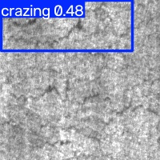
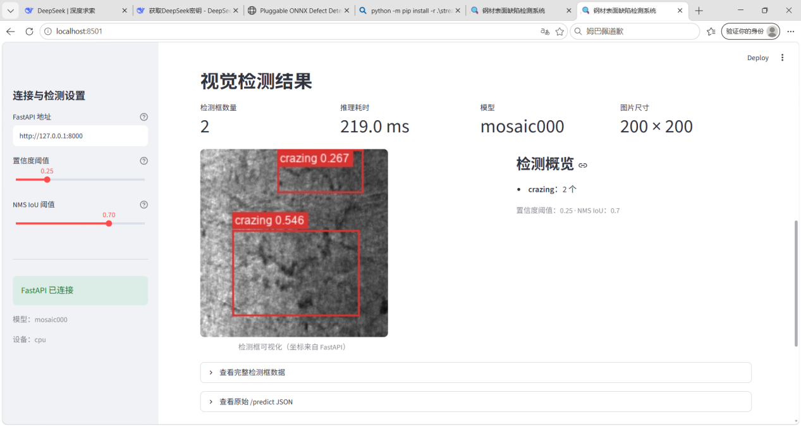
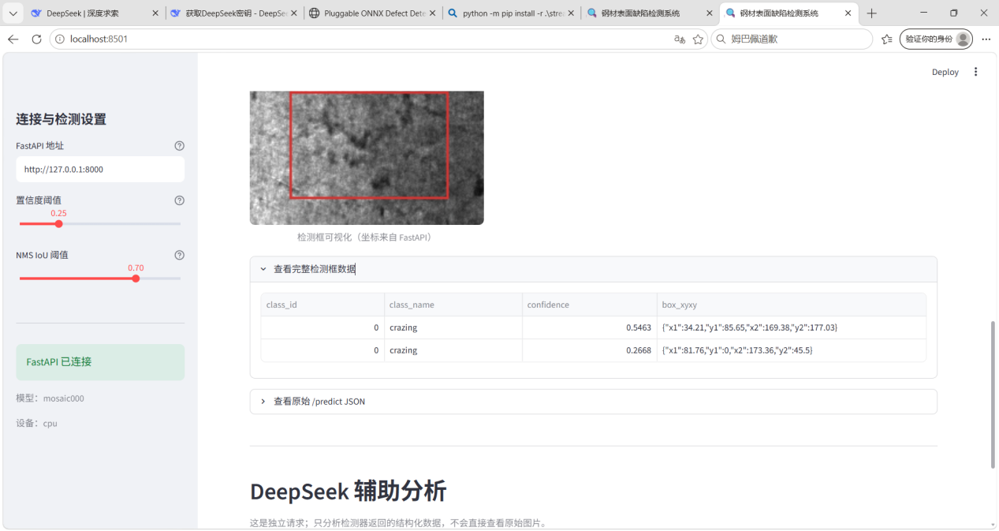
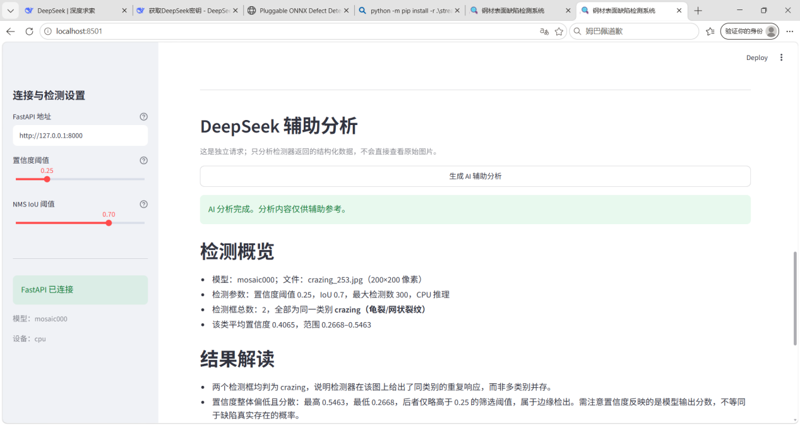
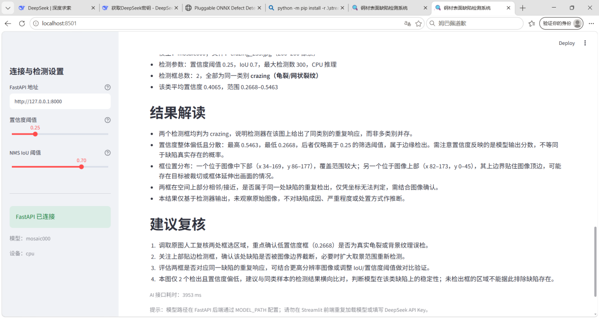
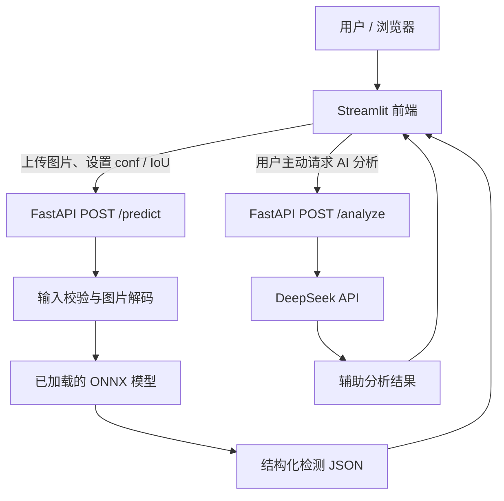

# Steel Defect Detection — 基于 YOLOv8 的钢材表面缺陷检测系统

<p align="center">
  <strong>NEU-DET · YOLOv8 · ONNX Runtime · FastAPI · DeepSeek API · Streamlit</strong>
</p>

<p align="center">
  <a href="https://wayne-steel-defect.streamlit.app">在线体验 Web 演示</a>
  ·
  <a href="https://github.com/Wayne007X/Steel-Defect-Detection">GitHub 仓库</a>
  ·
  <a href="https://github.com/Wayne007X/Steel-Defect-Detection/releases/tag/v1.0.0-models">候选模型下载</a>
</p>

这是一个基于公开 **NEU-DET 钢材表面缺陷数据集**的六类别目标检测项目。项目从 YOLOv8 基线训练出发，经历了训练策略对照、分类别错误分析、置信度与 NMS 阈值扫描、后处理实验、ONNX 导出与验证，再逐步搭建 FastAPI 推理服务、DeepSeek 辅助分析接口和 Streamlit 交互前端。

项目希望展示的不只是一个能画框的模型，还包括模型为什么这样选、哪些尝试没有达到目标、部署时遇到了什么问题、哪些结果已被验证，以及哪些风险仍然需要保留。本文中的结论尽量区分**标准验证指标、固定阈值诊断、单类别后处理实验和应用接口测试**，避免把不同评估口径的数字混为一谈。

> **当前状态：** 本地主要应用链路已跑通；`mosaic000` 与 `clean` 均有 FastAPI 冒烟测试通过记录，Streamlit 检测展示和一次实际 DeepSeek 分析也已成功运行。项目尚未完成独立测试集评估、全面的六类别端到端回归、并发压力测试或工业现场验收。ONNX 的 `predict()` 对照非常接近 PyTorch，但原生 `model.val()` 指标仍存在差异，详见下文。

## 目录

- [项目展示](#项目展示)
- [项目目标与技术架构](#项目目标与技术架构)
- [检测类别与数据集](#检测类别与数据集)
- [从基线到模型调优：完整实验历程](#从基线到模型调优完整实验历程)
- [模型候选与指标](#模型候选与指标)
- [为什么继续保留 mosaic000](#为什么继续保留-mosaic000)
- [后处理与阈值选择](#后处理与阈值选择)
- [ONNX 导出与验证](#onnx-导出与验证)
- [FastAPI、DeepSeek 与 Streamlit](#fastapideepseek-与-streamlit)
- [部署决策：单模型与阈值工作模式](#部署决策单模型与阈值工作模式)
- [本地运行指南](#本地运行指南)
- [接口与回归测试](#接口与回归测试)
- [项目资料与复现入口](#项目资料与复现入口)
- [已知限制与下一步](#已知限制与下一步)
- [安全与使用边界](#安全与使用边界)

## 项目展示

- **在线 Web 演示：** [Steel Defect Detection](https://wayne-steel-defect.streamlit.app)
- **候选 PyTorch 权重：** [GitHub Release — v1.0.0-models](https://github.com/Wayne007X/Steel-Defect-Detection/releases/tag/v1.0.0-models)

### 检测效果示例



### Streamlit 页面









在线演示与本地 FastAPI 部署链路是不同的运行入口。除非另行核对线上应用的配置，不应假定在线演示当前使用的权重、阈值和本地候选模型完全相同。

## 项目目标与技术架构

### 项目目标

1. 使用 YOLOv8 检测 NEU-DET 中的六类钢材表面缺陷。
2. 通过受控实验与分类别错误分析，判断哪些训练策略值得保留，而不是只追求单次实验的最高分。
3. 比较 Precision、Recall、mAP、漏检和误报之间的权衡，为不同使用目标保留有依据的候选模型。
4. 将 PyTorch 权重导出为 ONNX，检查推理可用性及与 PyTorch 的结果差异。
5. 使用 FastAPI 将视觉推理封装成独立服务；将 DeepSeek 设计为可选的结构化结果辅助分析；使用 Streamlit 提供浏览器交互。
6. 保留可复核的实验报告、接口测试和已知限制，为后续业务验证提供基础。

### 技术栈

| 模块 | 技术 / 组件 | 职责 |
|---|---|---|
| 数据集 | NEU-DET | 六类钢材表面缺陷图像及标注 |
| 目标检测 | YOLOv8n（主要路线） | 训练、预测与标准验证 |
| 深度学习环境 | Python、PyTorch、Ultralytics | 模型训练和评估 |
| 模型部署格式 | ONNX、ONNX Runtime | 将模型接入独立推理服务 |
| 后端接口 | FastAPI、Uvicorn | 健康检查、视觉推理、可选 AI 分析 |
| 辅助分析 | DeepSeek API | 解释检测器返回的结构化结果 |
| Web 前端 | Streamlit | 图片上传、阈值调整、结果可视化 |
| 测试与分析 | Python 脚本、CSV、Markdown 报告 | 阈值扫描、错误分析、ONNX 对照与接口回归 |

### 系统架构



视觉检测与 AI 分析是两个独立请求。DeepSeek 不负责识别原始图片，也不是 `/predict` 的前置依赖；它读取检测器输出的结构化 JSON，并生成辅助解读和复核建议。

## 检测类别与数据集

### 六类缺陷

| 类别 ID | 英文名称 | 中文名称 |
|---:|---|---|
| 0 | `crazing` | 龟裂 |
| 1 | `inclusion` | 夹杂 |
| 2 | `patches` | 斑块 |
| 3 | `pitted_surface` | 麻点表面 |
| 4 | `rolled-in_scale` | 氧化铁皮压入 |
| 5 | `scratches` | 划痕 |

### 数据集与评估口径

| 项目 | 当前实验记录 |
|---|---:|
| 数据集 | NEU-DET |
| 训练集 | 1,440 张图像 |
| 验证集 | 360 张图像 |
| 验证集标注目标 | 854 个 |
| 类别数 | 6 |
| 主线输入尺寸 | 640 × 640 |
| 主要模型 | YOLOv8n |
| 独立测试集 | 尚未建立 |

当前指标来自训练日志、现有验证集及专项诊断。**验证集结果不能视为独立测试成绩，也不能直接等同于真实产线的检测率。** 当不同脚本使用不同匹配规则、阈值或评估流程时，数值也不应直接横向比较。

### 开发与验证环境

| 项目 | 记录值 |
|---|---|
| 操作系统 / 终端 | Windows / PowerShell |
| Python | 3.10.11 |
| PyTorch | 2.5.1+cu121 |
| Ultralytics | 8.4.177 |
| ONNX / ONNX Runtime | 1.23.2 |
| 开发 GPU | NVIDIA GeForce RTX 3060 Laptop GPU，6 GB 显存 |
| 当前 FastAPI 推理设备 | CPU |
| ONNX 输入尺寸 | 640 |
| API 端口示例 | 8001 |
| Streamlit 端口示例 | 8501 |

虽然训练环境中的 PyTorch 版本带有 CUDA 标记，当前经过验证的 ONNX 服务仍显式使用 CPU。当前运行时没有报告 `CUDAExecutionProvider`，因此这里不将其描述为 ONNX GPU 推理。

## 从基线到模型调优：完整实验历程

本轮调优的核心原则逐渐从“尝试更多参数”转向“先建立可靠基线，再依据错误证据提出假设，并在实验前定义验收条件”。实验没有全部带来提升，但它们帮助我们排除了一些不值得继续投入的方向，并确定了两个用途不同的模型候选。

### 实验时间线与结论

| 阶段 | 尝试内容 | 结果与结论 |
|---|---|---|
| 1. 建立基线 | 使用 YOLOv8n、640 输入尺寸训练 `neu_defect_clean` | 得到可用的六类检测基线；整体指标尚可，但类别表现不均衡，龟裂和氧化铁皮压入值得重点诊断。 |
| 2. 推理阈值扫描 | 比较不同 `conf` 与 NMS IoU | 明确 Precision、Recall 与误报/漏检之间存在取舍；改变阈值改变的是工作点，并不等于训练出了更强的模型。 |
| 3. Mosaic 对照 | 比较 `mosaic050` 与 `mosaic000` | 当前实验条件下，`mosaic000` 的整体 Recall 更高，成为召回优先候选；它并未在所有指标上超过 `clean`。 |
| 4. 模型规模对照 | 尝试 YOLOv8s | 本次配置下未获得更好的整体 mAP，Recall 也更低，模型更大不代表效果必然更好。 |
| 5. 输入尺寸对照 | 比较 640、直接以 800 推理及 800 微调 | 800 路线没有超过原模型在 640 下的整体结果，当前主线保留 640。 |
| 6. 训练集 / 验证集错误分析 | 分析 TP、FP、FN、低置信度候选和类别错误 | 将问题从“某类效果不好”细化为可量化的漏检、背景误检、定位误差与重复/竞争预测。 |
| 7. `cls=0.75` | 从 `mosaic000` 出发调整分类损失权重 | 整体 mAP 与 Recall 未改善，未替换基线。 |
| 8. 龟裂定向采样 | 提高含 `crazing` 图片的采样权重 | 没有达到预设目标，整体指标下降，不继续单纯加大采样权重。 |
| 9. `box=8.5` | 调整框回归损失权重 | 未通过预先设定的验收门槛，不作为新主模型。 |
| 10. 学习率约 `0.0005` | 独立训练 `neu_defect_mosaic000_lr0005` | 未证明取得稳定、符合预设标准的收益，归档而不替换现有候选。 |
| 11. 专项后处理 | 对 `scratches` 预测框进行重复/竞争框筛选 | 在限定样本上取得局部 Precision/F1 改善，但只覆盖一个类别和 60 张图片，不能推断六类总体性能提高。 |

### 主要薄弱类别与错误分析

现有分析尤其关注：

- **`crazing`（龟裂）：** 存在较多低置信度候选与漏检。调低置信度可能找回部分候选，但也需要关注误报数量。
- **`rolled-in_scale`（氧化铁皮压入）：** 召回提高时，背景误检与定位相关误检也可能增加，不能只看 Recall。
- **`scratches`（划痕）：** 曾开展针对预测框的后处理实验；该实验属于单类别专项探索，不替代六类别统一评估。

一次固定阈值诊断中，`conf=0.25`、预测框与真实框匹配 IoU 为 0.50 时，`mosaic000` 的 TP/FP/FN 分别为 595/347/259，整体 Precision、Recall、F1 约为 0.632、0.697、0.663；`clean` 对应为 570/345/284，Precision、Recall、F1 约为 0.623、0.667、0.644。该组数字来自专项诊断脚本，和 Ultralytics 原生验证报告不是同一评估口径。

### 调优阶段的主要收获

1. 不再将“预测框数量减少”或“某张图看起来更好”直接视为模型能力提升。
2. 先用统一验证条件比较整体与分类别指标，再分析错误类型。
3. 训练策略、推理阈值和后处理是不同层次的工作，结论必须分开记录。
4. 对未通过验收标准的实验明确归档，不为了得到预期答案反复追加参数。
5. 当前阶段暂停无明确假设的训练，转向受控试运行、误报/漏检成本记录和工程验证。

## 模型候选与指标

当前保留两个角色不同的候选模型，而不是宣称其中一个在所有场景中绝对更优。

### 标准验证结果

| 模型 | Precision | Recall | mAP@0.5 | mAP@0.5:0.95 | 定位 |
|---|---:|---:|---:|---:|---|
| `neu_defect_clean` | 0.673 | 0.650 | **0.7281** | **0.3844** | 整体 mAP 基线 |
| `neu_defect_mosaic000` | 0.664 | **0.689** | 0.7260 | 0.3784 | 召回率优先候选 |

- `clean` 的整体 mAP 更高，适合作为后续对照基线。
- `mosaic000` 的整体 Recall 更高，适合在受控环境中研究召回优先的筛查策略。
- 选择模型时应同时考虑漏检风险、误报成本、人工复核工作量与缺陷严重程度。

## 为什么继续保留 mosaic000

这是本项目一个重要的工程决策：**不是因为 `mosaic000` 的每一项指标都更好，而是因为它提供了更偏向召回的工作起点，并且可以通过推理阈值调整误报与漏检之间的取舍。**

| 对比项 | `mosaic000` | `clean` | 如何理解 |
|---|---:|---:|---|
| Precision | 0.664（66.4%） | 0.673（67.3%） | `clean` 高 0.9 个百分点，意味着在当前评估口径下它的预测更精确一些 |
| Recall | **0.689（68.9%）** | 0.650（65.0%） | `mosaic000` 高 **3.9 个百分点**，在当前验证结果中找回了更大比例的真实缺陷 |
| mAP@0.5 | 0.7260（72.60%） | **0.7281（72.81%）** | 两者相差 0.0021，即 0.21 个百分点；单次验证不足以证明这点差异具有稳定的实际意义 |
| mAP@0.5:0.95 | 0.3784 | **0.3844** | `clean` 略高，说明不能把 `mosaic000` 描述为全指标胜出 |

### 为什么 Recall 的差距值得关注

工业质检场景通常需要认真评估漏检的代价：缺陷没有被模型提示出来，后续流程可能就没有机会复核它。当前记录中，`mosaic000` 的 Recall 为 68.9%，`clean` 为 65.0%，相差 3.9 个百分点。这个差距值得在后续试运行中重点验证，但**不能直接换算成“必然少漏检多少件产品”**：实际影响取决于缺陷发生率、样本分布、阈值、相机与产线条件，以及模型在真实数据上的泛化表现。

与此同时，`mosaic000` 的 Precision 较低，意味着按当前工作点统计，误报负担可能更高。因此，本项目不应只追求 Recall，也不应只因 `clean` 的 mAP 略高就立即放弃 `mosaic000`。合理做法是先明确业务更怕漏检还是更怕误报，再用同一套验证流程比较模型与阈值组合。

### 为什么不直接部署两套 ONNX

如果应用暂时只需要一个主要检测入口，固定部署一套经过验证的 ONNX 模型、由用户调整 `conf` 工作点，通常比同时加载两套模型更简单：

- FastAPI 只需维护一套模型加载与预热流程，降低双模型驻留带来的内存占用。
- Streamlit 不必额外维护模型选择器、模型切换状态和两套结果说明。
- 测试矩阵更小，减少切换模型后标签、参数、日志或模型路径不一致的排查成本。
- 可以先用阈值为不同业务流程提供偏严格和偏召回的操作方式，再根据真实数据决定是否确实需要双模型。

这是一项**工程简化策略**，不是模型等价性结论。调整阈值只能改变候选框保留策略，不能让 `mosaic000` 的权重、类别特征和定位行为变成 `clean`。如果后续验证发现两者在某些类别上存在互补优势，或者业务明确要求按场景选择模型，那么保留双模型入口仍然可能是合理的。

### 固定阈值工作点

调优报告建议从以下工作点开始受控验证：

| 目标 | 模型 / 参数 | 现有验证结果的解释 |
|---|---|---|
| 召回优先 | `mosaic000`，`conf=0.20`、NMS IoU `0.30` | 阈值扫描中的整体 Recall 约为 0.70；适合观察漏检减少是否值得额外复核误报。 |
| F1 对照 | `mosaic000`，`conf=0.25`、NMS IoU `0.30` | 整体 F1 约为 **0.6993**；相较 `conf=0.20`，误报数量减少，但并不代表所有类别都同时变好。 |

不同阶段的固定阈值结果曾因诊断脚本和评估口径略有差异；例如已有记录中整体 Recall 约为 0.700–0.701。它们用于比较工作点，不应与标准验证 mAP 或其他匹配规则下的结果混算。最终阈值应在同一评估脚本和同一批样本上复核。

### 用置信度阈值提供两种操作模式

本项目的 Streamlit 前端可以调整置信度阈值，FastAPI `/predict` 也接收对应推理参数。实际使用时，可以把滑块解释为两种不同的**操作模式**：

| 操作模式 | 可用于初步试验的 `conf` | 预期倾向 | 适合的工作流程 |
|---|---:|---|---|
| **严格模式 / 高置信度优先** | 例如 `0.50` | 通常会减少低置信度候选和部分误报，但也可能漏掉更多真实缺陷 | 让人工优先查看高置信度告警，或作为后续复核队列的一个筛选条件 |
| **筛查模式 / 召回优先** | 例如 `0.25` | 通常能保留更多候选、争取降低漏检，但误报和人工复核量可能上升 | 初筛、辅助巡检、需要尽量保留疑似缺陷的场景 |

这里的 `0.50` 与 `0.25` 是便于理解的**起始试验值，不是已经对所有业务验证过的最终阈值**。改变 `conf` 后，Precision 和 Recall 的实际数值应以同一验证集、同一匹配规则下重新计算的结果为准。若将阈值调得更高，不能据此保证 Precision 必然达到某个数值；阈值也不应脱离类别、图像来源和业务成本单独决定。

需要特别说明：**严格模式不等于自动判废，筛查模式也不等于保证不漏检。** 两种模式只是让同一模型在不同工作点运行。上线前应由代表性数据验证每个工作点的误报量、漏检量和人工复核成本，并保留原始检测结果以便追溯。

### 下载候选权重

| 权重文件 | 用途 | 下载 |
|---|---|---|
| `neu_defect_clean_best.pt` | 整体 mAP 基线 | [下载 `.pt`](https://github.com/Wayne007X/Steel-Defect-Detection/releases/download/v1.0.0-models/neu_defect_clean_best.pt) |
| `neu_defect_mosaic000_best.pt` | 召回率优先候选 | [下载 `.pt`](https://github.com/Wayne007X/Steel-Defect-Detection/releases/download/v1.0.0-models/neu_defect_mosaic000_best.pt) |

[查看完整模型发布页](https://github.com/Wayne007X/Steel-Defect-Detection/releases/tag/v1.0.0-models)。权重与普通源码分开分发。发布候选权重不代表在线演示站点已自动切换到这些权重，也不代表候选模型已经通过工业验收。

## 后处理与阈值选择

除了训练模型，本项目还单独研究了推理阈值与预测框后处理。这里必须区分三件事：

- **训练调优：** 改变模型学到的参数或训练过程。
- **推理参数：** 通过 `conf` 和 NMS IoU 决定保留哪些候选框。
- **后处理：** 对已有预测框进一步筛选或合并，不会改变模型权重。

### `conf` 与 NMS IoU 扫描示例

在一轮 360 张验证图片的扫描中，预测框与真实框匹配 IoU 为 0.50 时，记录如下：

| 推理参数 | Precision | Recall | F1 |
|---|---:|---:|---:|
| `conf=0.30, NMS IoU=0.30` | 0.780 | 0.609 | **0.684** |
| `conf=0.40, NMS IoU=0.30` | **0.842** | 0.550 | 0.666 |
| `conf=0.30, NMS IoU=0.70` | 0.687 | 0.618 | 0.651 |
| `conf=0.30, NMS IoU=0.45` | 0.757 | **0.612** | 0.677 |

这组结果来自早期的一轮阈值扫描，仅用于说明参数权衡，不应与后续候选模型的指标直接比较。提高 `conf` 通常会减少低置信度误报，但也可能漏掉弱缺陷；NMS IoU 会改变重叠预测框被保留或抑制的情况。

### `scratches` 单类别后处理案例

在 60 张划痕图片的专项实验中，后处理把预测框数量从 220 个降到 161 个。按当时采用的真实标签匹配规则与 IoU 阈值 0.50 统计，第二轮后处理的 Precision 从约 0.450 提高到约 0.615，Recall 约维持在 0.798，F1 从约 0.576 提高到约 0.695。

这是一个有价值的局部结果，但范围仅限于**一个类别、60 张图片和特定后处理规则**。它不能证明六类模型整体性能改善，也不能替代统一验证。后续如果将此类逻辑用于实际系统，应单独进行多类别回归，检查是否误删真实目标。

## ONNX 导出与验证

### 导出结果

项目将候选 PyTorch 权重导出为 ONNX，`mosaic000` 的记录如下：

| 项目 | 记录值 |
|---|---|
| 输入形状 | `(1, 3, 640, 640)` |
| 输出形状 | `(1, 10, 8400)` |
| ONNX opset | 18 |
| 文件大小 | 约 12.16 MB |
| 推理封装 | Ultralytics ONNX wrapper |
| 当前服务设备 | CPU |

### `predict()` 数值对照

在同一批 360 张验证图片、CPU 对 CPU 的一次 `predict()` 对照中，`mosaic000` 记录为：

| 对照项 | PyTorch | ONNX |
|---|---:|---:|
| 检测框总数 | 22,413 | 22,412 |
| 匹配检测框 | 22,412 | 22,412 |
| 未匹配检测框 | 1 | 0 |
| 平均匹配 IoU | — | 约 0.999988 |
| 匹配框平均置信度绝对差 | — | 约 0.000000099 |

这说明在该次 `predict()` 对照条件下，两个后端输出的检测框位置和置信度非常接近。但它不能证明两种后端的所有预处理、后处理与验证流程都完全相同。

### 原生 `model.val()` 指标差异：仍是已知限制

同一份 `mosaic000` 权重的原生验证记录如下：

| 指标 | PyTorch `best.pt` | ONNX `best.onnx` | ONNX - PyTorch |
|---|---:|---:|---:|
| Precision | 0.664 | 0.665 | +0.001 |
| Recall | 0.687 | 0.673 | -0.014 |
| mAP@0.5 | 0.726 | 0.702 | -0.024 |
| mAP@0.5:0.95 | 0.378 | 0.361 | -0.017 |

排查中还发现，自定义评估器曾与 Ultralytics 原生验证结果存在明显差距，因此没有继续将未经证明等价的自定义评估器作为正式指标来源。`rect=True/False` 的复核也没有证明仅切换该参数就能消除 ONNX 与 PyTorch 的原生验证差异。

**当前结论：** ONNX 文件导出成功、可以运行，且 `predict()` 数值对照非常接近；但是原生 `model.val()` 的指标差异尚未完全解释。如果后续交付标准对 ONNX mAP 有明确要求，需要围绕该要求继续定位和验收。不能仅凭检测框高度一致就跳过指标验收，也不能为了让数字一致而覆盖已有验证记录。

### ONNX Runtime 的 CPU 运行策略

当前 API V4 显式采用 CPU-only 初始化：在导入 Ultralytics 前关闭自动安装和 CUDA 可见性，启动阶段执行 CPU 预热，预热与 `/predict` 均显式使用 `device="cpu"`。日志中可用 provider 包含 `AzureExecutionProvider` 与 `CPUExecutionProvider`，未包含 `CUDAExecutionProvider`。

项目曾遇到 Ultralytics 尝试自动安装 `onnxruntime-gpu`，并因 Windows DLL 文件占用或权限问题失败的情况。当前优先保留已验证的 CPU 路径，而不是为了理论上的加速反复更换运行时。若未来需要 GPU，应在独立环境中检查驱动、CUDA、运行时 provider 和实际性能。

## FastAPI、DeepSeek 与 Streamlit

### FastAPI：独立视觉推理服务

正式推荐的本地后端入口为：

`onnx_inference_api_pluggable_v4.py`

V3 作为历史版本备份；除非确认实际文件与测试结果，否则不要把旧版本当作默认入口。

后端在服务启动阶段加载指定 ONNX 模型，并通过环境变量控制模型路径和显示标签。它负责输入校验、推理、结构化 JSON 响应与健康检查。Streamlit 不直接加载模型，而是通过 HTTP 调用后端。

### DeepSeek：可选的结构化结果辅助分析

`POST /analyze` 将视觉检测器返回的 JSON 发送给 DeepSeek，生成检测概览、结果解读和建议复核内容。当前设计**不会把原始图片传给 DeepSeek**，因此它不应声称自己直接观察或验证了图片中的缺陷。

这种拆分带来几个好处：

1. 用户可以先获得视觉检测结果，再决定是否请求 AI 分析。
2. 未配置 `DEEPSEEK_API_KEY` 时，视觉检测接口仍可独立使用。
3. AI 结果作为辅助信息展示，不覆盖检测器的原始输出。
4. AI 服务响应较慢或不可用时，可以更清楚地显示分析状态。

已经验证过未配置密钥时的结构化降级响应；也曾在 Streamlit 页面中观察到一次实际 AI 分析成功。真实网络超时、断网和服务端异常的完整故障注入仍待补充。

### Streamlit：浏览器交互界面

当前前端入口为 `streamlit_frontend.py`，主要功能包括：

- 上传待检测图片；
- 设置 FastAPI 地址；
- 调整置信度阈值和 NMS IoU；
- 查看服务连接状态、模型标签和设备信息；
- 显示检测框、类别、置信度、检测数量、图片尺寸与推理耗时；
- 展开查看检测条目及原始 `/predict` JSON；
- 主动请求 DeepSeek 辅助分析，并展示分析状态、概览、解读与复核建议。

## 部署决策：单模型与阈值工作模式

当前推荐的简化部署方式是：**FastAPI 启动时加载一套指定 ONNX 权重，Streamlit 通过阈值滑块改变推理工作点。** 例如，可以先以 `mosaic000` 作为召回率优先候选，再让用户在严格模式与筛查模式之间调整 `conf`；不需要仅仅为了提供两种操作倾向，就默认同时加载 `clean` 和 `mosaic000`。

这样做可以减少模型驻留内存、启动与预热逻辑、前端切换状态和回归测试组合。不过，模型文件仍由 `MODEL_PATH` 决定；要切换到 `clean`，目前需要按本地运行指南停止并重启 FastAPI，而不是假定阈值滑块会自动切换模型。

后续是否需要双模型，应由验证结果决定：如果真实数据证明两个模型在不同缺陷类别或业务条件下有稳定、可重复的互补优势，且这种收益足以抵消内存、维护与测试成本，再实现明确的模型选择功能。否则，优先把单模型、阈值配置、日志记录和端到端回归做扎实。

### API 接口

| 方法与路径 | 用途 | 是否依赖 DeepSeek |
|---|---|---|
| `GET /health` | 服务状态、模型标签、设备、输入尺寸、类别名和运行时 provider | 否 |
| `POST /predict` | 上传图片并返回检测框、类别、置信度、图片尺寸与耗时 | 否 |
| `POST /analyze` | 对检测器输出的结构化 JSON 生成辅助解读 | 是 |
| `GET /docs` | FastAPI Swagger 交互文档 | 否 |

`/predict` 返回的检测框使用原图像素坐标 `xyxy`。置信度是模型对预测框的评分，不等同于缺陷真实存在的概率。

## 本地运行指南

以下命令依据已验证的 Windows 开发环境编写。示例路径为 `E:\yolo_project`，Python 环境为 `E:\yolo_workspace`；在其他机器上需要替换为实际路径。

### 1. 准备环境

```powershell
cd E:\yolo_project
E:\yolo_workspace\Scripts\Activate.ps1

python -m pip install -r .\requirements_api_v4.txt
python -m pip install -r .\streamlit_frontend_requirements.txt
```

上述两个文件主要负责 API 层和 Streamlit 层依赖。全新环境还需要安装与 Python、Ultralytics 和 ONNX 模型兼容的核心推理依赖，包括 CPU 版 `onnxruntime`、`ultralytics` 等。请按项目实际依赖清单安装并在目标环境验证。当前 CPU-only 服务不需要为了消除提示而盲目安装 `onnxruntime-gpu`。

### 2. 启动 FastAPI

在第一个 PowerShell 终端中执行，并保持终端运行：

```powershell
cd E:\yolo_project
E:\yolo_workspace\Scripts\Activate.ps1

$env:MODEL_PATH = "E:\yolo_project\runs\neu_defect_mosaic000\weights\best.onnx"
$env:MODEL_NAME = "mosaic000"

# 只有需要 DeepSeek 分析时才设置密钥；不要将真实密钥写入源码或提交到 Git。
# $env:DEEPSEEK_API_KEY = "你的实际 API Key"

python -m uvicorn onnx_inference_api_pluggable_v4:app --host 127.0.0.1 --port 8001 --workers 1
```

等待日志出现 `Application startup complete` 后，在另一个终端检查健康状态：

```powershell
Invoke-RestMethod -Uri "http://127.0.0.1:8001/health" -TimeoutSec 10 |
    ConvertTo-Json -Depth 5
```

重点确认 `status=ok`、`model=mosaic000`、`device=cpu`、`imgsz=640`，以及六类 `class_names` 均存在。也可以打开 [Swagger 文档](http://127.0.0.1:8001/docs)。

### 3. 启动 Streamlit

在第二个独立的 PowerShell 终端中执行：

```powershell
cd E:\yolo_project
E:\yolo_workspace\Scripts\Activate.ps1

$env:FASTAPI_BASE_URL = "http://127.0.0.1:8001"
python -m streamlit run .\streamlit_frontend.py
```

按终端输出的地址打开页面，通常为 `http://localhost:8501`。前端的 `FASTAPI_BASE_URL` 必须与后端实际端口一致。

### 4. 配置 DeepSeek API Key

密钥应在启动 FastAPI 的同一个 PowerShell 会话中设置，并在启动服务前完成。可用安全输入方式，避免把密钥直接写进命令历史：

```powershell
$secure = Read-Host "请输入 DeepSeek API Key" -AsSecureString
$env:DEEPSEEK_API_KEY = [System.Net.NetworkCredential]::new('', $secure).Password
```

随后启动或重启 FastAPI。已经运行的服务不会自动读取后来才设置的环境变量。没有配置密钥时，视觉检测仍可使用，AI 分析则应返回不可用/降级状态。

### 5. 切换模型

先在 FastAPI 终端按 `Ctrl+C` 停止旧服务，再配置并重启。例如切换到 `clean`：

```powershell
$env:MODEL_PATH = "E:\yolo_project\runs\neu_defect_clean\weights\best.onnx"
$env:MODEL_NAME = "clean"

python -m uvicorn onnx_inference_api_pluggable_v4:app --host 127.0.0.1 --port 8001 --workers 1
```

重启后重新访问 `/health` 确认 `model=clean`。只修改当前 PowerShell 环境变量不会使已经加载模型的进程自动切换权重。

## 接口与回归测试

### 已有回归记录

测试图片为 `crazing_253.jpg`（200 × 200），主要用于验证接口契约与基本推理路径。

| 测试项 | 已记录结果 | 说明 |
|---|---|---|
| `mosaic000` 常规 API 冒烟测试 | **14/14 通过** | 健康检查、响应结构、类别、坐标、置信度与异常输入 |
| `mosaic000` 含 `/analyze` 契约检查 | **16/16 通过** | 当次测试验证了未配置密钥时的降级路径；不代表该次实际调用 DeepSeek |
| `clean` 常规 API 冒烟测试 | **14/14 通过** | 使用正确的 `--expected-model clean` 后通过 |
| V4 CPU 后端启动 | 已验证 | 日志显示 CPU warm-up 完成，设备明确为 CPU |
| Streamlit 检测可视化 | 已观察到成功结果 | 页面展示检测框、类别、置信度、检测数量、模型标签和图片尺寸 |
| Streamlit DeepSeek 分析 | 已观察到一次成功结果 | 页面显示分析完成、概览、结果解读和复核建议 |
| DeepSeek 超时 / 断网故障注入 | 待补充 | 尚无完整的专门故障注入记录 |
| 六类别多图片端到端回归 | 待补充 | 现有详细接口日志主要来自单张龟裂图片 |

已验证的输入校验包括：空文件和无法解码的非图片返回 HTTP 400；超过 10 MiB 的图片返回 HTTP 413；非法置信度参数返回 HTTP 422；检测数量与检测条目数一致；框坐标合法并采用原图像素坐标；类别 ID 与类别名称一致；置信度位于 `[0, 1]` 范围内。

### 运行实时冒烟测试

如果脚本已整理到 `scripts\testing\verify_fastapi_live.py`：

```powershell
python .\scripts\testing\verify_fastapi_live.py `
  "D:\yolov8\NEU-DET\validation\images\crazing\crazing_253.jpg" `
  --base-url "http://127.0.0.1:8001" `
  --expected-model mosaic000
```

需要检查 `/analyze` 契约时，可追加 `--test-analyze`。此选项可能触发真实 AI 请求并消耗 API 额度；如果没有配置密钥，测试验证的可能是降级路径，而非在线分析成功。

单张测试图片上的检测数、置信度与耗时仅是该次运行的观测值，不代表六类总体性能或固定的性能承诺。

## 项目资料与复现入口

项目中保留了训练脚本、实验索引、CSV 指标、ONNX 排查记录、部署说明和回归测试记录。建议将这些资料与 README 一起维护，方便后续复核实验决策和继续开发。

- [完整模型调优实验报告](reports/NEU-DET_model_tuning_report.md)
- [实验索引](experiments/neu_det_tuning/EXPERIMENT_INDEX.md)
- [实验归档清单](experiments/neu_det_tuning/results/artifact_manifest.csv)
- [三模型标准验证指标](deployment_model_comparison/three_model_standard_metrics.csv)
- [ONNX 导出与一致性验证记录](onnx_fast_api_streamlit_docs/MOSAIC000_ONNX_导出与验证排查记录_补充部署决策.md)
- [部署架构与端到端回归记录](onnx_fast_api_streamlit_docs/钢材表面缺陷检测系统：部署架构与端到端回归记录.md)
- [四阶段完整项目记录与使用手册](onnx_fast_api_streamlit_docs/钢材表面缺陷检测系统：四阶段完整项目记录与使用手册.md)
- [端到端回归测试记录](onnx_fast_api_streamlit_docs/钢材表面缺陷检测系统：端到端回归测试记录.md)

> 提交 README 前，请核对上述相对路径与 GitHub 中的实际目录、文件名一致。如果某份报告尚未提交或已经改名，应同步修正链接。模型权重、数据集、`runs/` 产物、虚拟环境、缓存和密钥不应混入普通源码提交；候选权重可继续通过 GitHub Releases 分发。

## 已知限制与下一步

### 已知限制

1. **没有独立测试集。** 当前模型比较与阈值分析主要基于训练集和 360 张验证图片，可能存在对验证集过度适配的风险。
2. **ONNX 原生验证指标差异尚未完全解释。** `predict()` 数值对照高度接近，但 `model.val()` 中 ONNX 的 mAP@0.5 与 mAP@0.5:0.95 低于 PyTorch 记录。
3. **类别表现不均衡。** 龟裂仍有漏检与低置信度候选，氧化铁皮压入的召回提升可能伴随更多误报。
4. **阈值工作点需要业务验证。** `conf=0.50` 和 `conf=0.25` 在 README 中仅作为严格/筛查模式的示例起点，不代表已经达到确定的 Precision、Recall 或自动判定标准。
5. **多类别回归覆盖不足。** 详细接口日志主要来自一张龟裂图片，尚不能宣称六类、不同尺寸、无目标图片和边界输入都已全面覆盖。
6. **AI 网络异常测试不足。** 已验证未配置密钥时的降级路径，也观察到一次真实 AI 分析成功；但超时、断网和远端服务异常仍需专门测试。
7. **当前服务走 CPU 路径。** GPU provider 未在当前运行时中得到验证。
8. **尚未完成生产级验收。** 还需要真实采集批次、不同光照和相机条件、并发吞吐量、人工复核成本与业务验收标准。

### 建议的后续工作

- 获取独立来源或不同生产批次的数据，评估模型泛化能力。
- 为六个类别各选择多张代表图片，补齐 API 与 Streamlit 的端到端回归。
- 增加无缺陷图片、不同分辨率、长宽比、边缘目标和连续上传测试。
- 通过受控方式模拟 DeepSeek 超时、断网和服务端错误，确认视觉检测结果仍然保留。
- 如果 ONNX mAP 是交付门槛，继续在统一数据、参数和评估流程下定位原生验证差异。
- 在真实业务流程中记录 TP、FP、FN、人工复核耗时、漏检风险和误报成本，再决定最终模型与阈值。
- 保留已验证的 CPU 版本作为回退基线；只有在有明确需求时再单独评估 GPU 部署。

## 安全与使用边界

- 不要把 `DEEPSEEK_API_KEY` 或其他凭据写入代码、README、截图或公开仓库。
- 本地路径是开发环境示例，其他机器需按实际路径调整。
- 当前 API 示例监听 `127.0.0.1`，适用于本地使用。若对外开放，应另行配置认证、HTTPS、访问控制、限流和部署安全措施。
- 检测置信度是模型评分，不是缺陷真实存在的概率。
- DeepSeek 只读取检测器的结构化输出，不直接查看原图；其解释应作为辅助信息。
- 工业质量判定应结合原图、人工复核、经过验证的业务规则和适用的质量标准，不应由当前模型或 AI 文本单独决定放行、降级或报废。

## 项目总结

本项目的完整路径是：

**NEU-DET 数据准备 → YOLOv8 基线训练 → 受控调优与错误分析 → 候选模型选择 → 阈值扫描与专项后处理 → ONNX 导出和一致性核查 → FastAPI 视觉推理 → DeepSeek 辅助分析 → Streamlit 交互展示 → 端到端回归测试。**

项目的价值不只在于形成了可交互演示的应用，也在于把模型选择和部署排查过程沉淀成可复核记录：哪些方案有效、哪些没有达到验收标准、为什么保留两个候选、ONNX 与 PyTorch 还存在哪些差异，以及哪些工程风险尚未覆盖。当前最合理的方向是保留已经跑通的应用链路，以明确的证据推进下一阶段验证，而不是为了追求更多实验次数而反复修改模型。

---
