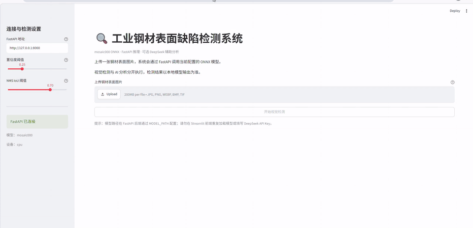
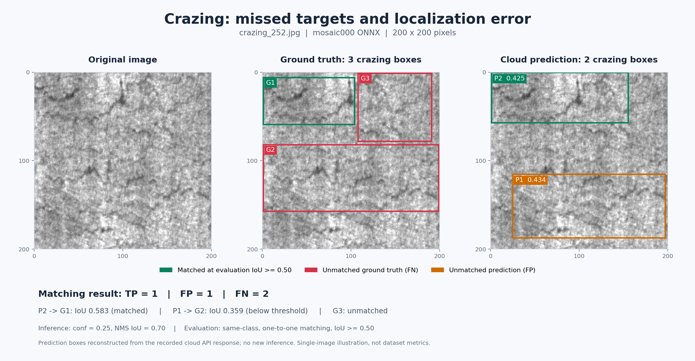
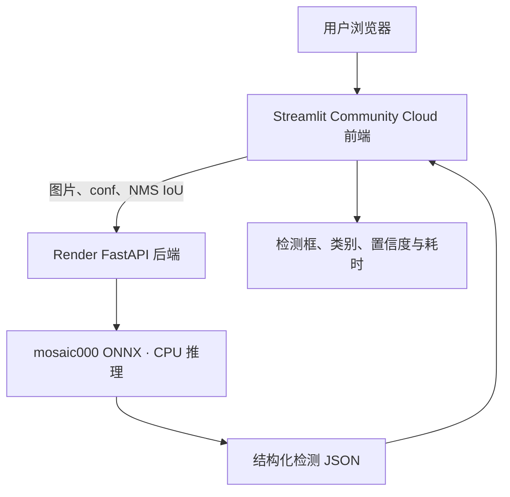

# Steel Defect Detection｜基于 YOLOv8 的钢材表面缺陷检测系统

<p align="center">
  <strong>NEU-DET · YOLOv8 · ONNX Runtime · FastAPI · DeepSeek API（本地可选）· Streamlit · Render</strong>
</p>

<p align="center">
  <a href="https://steel-defect-detection-52wcl85z79gio5qv82slyd.streamlit.app">在线体验</a> ·
  <a href="https://github.com/Wayne007X/Steel-Defect-Detection">GitHub 仓库</a> ·
  <a href="https://github.com/Wayne007X/Steel-Defect-Detection/releases/tag/v1.0.0-models">候选模型下载</a>
</p>

基于 **NEU-DET** 的六类钢材表面缺陷检测项目，覆盖模型训练、对照实验、错误分析、ONNX 导出、推理 API、交互页面和云端部署。

用户可上传图片、调整置信度与 NMS IoU、查看检测框和结构化结果。本地还可主动调用 **DeepSeek**，对检测结果生成辅助解读；云端保留纯视觉检测，关闭 AI 调用。

> **更新记录：2026-10-30。** 已完成云端前后端图片检测验收，新增经标注核对的正常检出与定位/漏检案例，以及包含真实 DeepSeek 分析的本地操作 GIF。以下展示材料证明对应样本和功能的实际表现，不替代完整数据集评估。

## 目录

- [项目展示](#项目展示)
- [项目目标与技术架构](#项目目标与技术架构)
- [检测类别与数据集](#检测类别与数据集)
- [模型候选与指标](#模型候选与指标)
- [从基线到模型调优：完整实验历程](#从基线到模型调优完整实验历程)
- [后处理与阈值选择](#后处理与阈值选择)
- [ONNX 导出与验证](#onnx-导出与验证)
- [FastAPI、DeepSeek 与 Streamlit](#fastapideepseek-与-streamlit)
- [云端部署与上线验收](#云端部署与上线验收)
- [本地运行指南](#本地运行指南)
- [接口与回归测试](#接口与回归测试)
- [测试摘要](#测试摘要)
- [项目资料与复现入口](#项目资料与复现入口)
- [已知限制与下一步](#已知限制与下一步)
- [安全与使用边界](#安全与使用边界)

## 项目展示

### 本地完整流程演示



**上传图片 → 调整阈值 → 执行视觉检测 → 查看检测框 → 主动请求 DeepSeek → 展示辅助解读。**

GIF 约 **29.5 秒**，由本地操作录像剪辑，压缩了重复操作与等待片段，不用于衡量响应速度。图像检测使用本地 ONNX 模型；DeepSeek 通过网络分析检测结果 JSON，不直接读取原图。**这是本地功能演示，云端没有开放 AI 分析。**

### 正常检出案例：斑块


`patches_244.jpg` 包含两个已标注斑块，模型分别检出。上方和下方目标的预测置信度约为 **0.829、0.865**，与对应标注的 IoU 约为 **0.863、0.851**。

按同类别、一对一匹配、评估 IoU ≥ 0.50，该图为 **TP=2、FP=0、FN=0**。结果仅代表当前样本，不意味着其他图片也没有漏检或误检。

### 局限性案例：龟裂漏检与定位偏差



`crazing_252.jpg` 有三个真实标注，模型输出两个龟裂预测框：

- 上方预测框与左上标注匹配，IoU 约 **0.583**。
- 下方预测框位置偏下，与中下部标注的 IoU 约 **0.359**，没有达到匹配阈值。
- 右上标注没有独立匹配的预测框。

在相同评估规则下，该图为 **TP=1、FP=1、FN=2**。下方预测框反映了定位偏差，不能仅因统计上计入 FP 就称为纯背景误检。这个案例也说明：**返回两个框、接口响应成功，不等于目标全部正确检出。**

### 案例参数与解释口径

| 项目 | 配置 / 说明 |
|---|---|
| 模型 | `mosaic000` ONNX，CPU 推理 |
| 样本 | `patches_244.jpg`、`crazing_252.jpg`，原图均为 200 × 200 |
| 输入尺寸 | `imgsz=640` |
| 置信度阈值 | `conf=0.25` |
| NMS IoU | `0.70`，用于预测框抑制 |
| 评估 IoU | `0.50`，用于预测与真实标注的一对一匹配 |
| 对照图来源 | 已上传原图、YOLO 标注及此前云端返回的预测数据；制图时没有重新推理 |
| 标记 | 绿色为成功匹配；红色为未匹配标注；橙色为未匹配预测 |

TP、FP、FN 分别表示成功匹配预测、未匹配预测、未匹配真实标注。两个样本是人工选择的展示案例，不是随机抽样测试，也不作为六类整体指标。

### 在线体验

- **检测网页：** [打开 Streamlit 演示](https://steel-defect-detection-52wcl85z79gio5qv82slyd.streamlit.app)
- **后端状态：** [GET /health](https://steel-defect-api-ud3q.onrender.com/health)
- **接口文档：** [Swagger UI](https://steel-defect-api-ud3q.onrender.com/docs)

打开网页 → 上传图片 → 调整参数 → 点击“开始视觉检测”。滑块修改后需重新点击检测，画面不会随滑块实时更新。应用校验的单图上传上限为 **10 MiB**，不是上传控件可能显示的平台默认 200 MB。

曾观察到健康检查超过前端的 3 秒等待上限，随后连接与检测恢复；当次未通过后端日志确定原因。遇到连接超时，可先打开健康接口等待响应，再刷新前端；持续失败应查看 Render 日志，不需要启动自己电脑上的服务来恢复云端。


## 项目目标与技术架构

### 项目目标

1. 使用 YOLOv8 检测 NEU-DET 中的六类钢材表面缺陷。
2. 通过受控实验与分类别错误分析，判断哪些训练策略值得保留，而不是只追求单次实验的最高分。
3. 比较 Precision、Recall、mAP、漏检和误报之间的权衡，为不同使用目标保留有依据的候选模型。
4. 将 PyTorch 权重导出为 ONNX，检查推理可用性及与 PyTorch 的结果差异。
5. 使用 FastAPI 将视觉推理封装成独立服务；将 DeepSeek 设计为可选的结构化结果辅助分析；使用 Streamlit 提供浏览器交互。
6. 保留可复核的实验报告、接口测试和已知限制，为后续业务验证提供基础。

### 技术栈

| 模块 | 技术 / 组件 | 职责 |
|---|---|---|
| 数据集 | NEU-DET | 六类钢材表面缺陷图像及标注 |
| 目标检测 | YOLOv8n（主要路线） | 训练、预测与标准验证 |
| 深度学习环境 | Python、PyTorch、Ultralytics | 模型训练和评估 |
| 模型部署格式 | ONNX、ONNX Runtime | 将模型接入独立推理服务 |
| 后端接口 | FastAPI、Uvicorn | 健康检查、视觉推理、可选 AI 分析 |
| 辅助分析（仅本地按需启用） | DeepSeek API | 解释检测器返回的结构化结果；云端关闭 |
| 云端托管 | Render + Streamlit Community Cloud | 分别托管后端推理服务和交互前端 |
| Web 前端 | Streamlit | 图片上传、阈值调整、结果可视化 |
| 测试与分析 | Python 脚本、CSV、Markdown 报告 | 阈值扫描、错误分析、ONNX 对照与接口回归 |

### 系统架构



云端前后端通过 HTTPS 通信，前端不直接加载模型。后端启动时加载一次 ONNX 模型并完成 CPU 预热。

本地仍保留独立的 `POST /analyze`：只有显式开启 DeepSeek 且后端配置有效密钥时，用户才能主动请求分析。DeepSeek 读取的是检测结果 JSON，不接收原始图片，也不是 `/predict` 的依赖。

| 功能 | 云端演示 | 本地运行 |
|---|---|---|
| 图片上传、六类检测与结果展示 | 可用 | 可用 |
| 置信度 / NMS IoU 调整 | 可用 | 可用 |
| DeepSeek 分析区域 | 隐藏 | 开关开启时显示 |
| `/analyze` | 关闭，合法分析请求返回 403 | 开关开启且配置密钥后可调用 |
| 用户自行输入 API Key | 未实现 | 后端通过环境变量配置 |

`ENABLE_DEEPSEEK` 默认关闭。云端前后端均显式配置为 `false`，不配置 `DEEPSEEK_API_KEY`。

## 检测类别与数据集

### 六类缺陷

| 类别 ID | 英文名称 | 中文名称 |
|---:|---|---|
| 0 | `crazing` | 龟裂 |
| 1 | `inclusion` | 夹杂 |
| 2 | `patches` | 斑块 |
| 3 | `pitted_surface` | 麻点表面 |
| 4 | `rolled-in_scale` | 氧化铁皮压入 |
| 5 | `scratches` | 划痕 |

### 数据集与评估口径

| 项目 | 当前实验记录 |
|---|---:|
| 数据集 | NEU-DET |
| 训练集 | 1,440 张图像 |
| 验证集 | 360 张图像 |
| 验证集标注目标 | 854 个 |
| 类别数 | 6 |
| 主线输入尺寸 | 640 × 640 |
| 主要模型 | YOLOv8n |
| 独立测试集 | 尚未建立 |

当前指标来自训练日志、现有验证集及专项诊断。**验证集结果不能视为独立测试成绩，也不能直接等同于真实产线的检测率。** 当不同脚本使用不同匹配规则、阈值或评估流程时，数值也不应直接横向比较。

### 开发与验证环境

| 项目 | 记录值 |
|---|---|
| 操作系统 / 终端 | Windows / PowerShell |
| Python | 3.10.11 |
| PyTorch | 2.5.1+cu121 |
| Ultralytics | 8.4.177 |
| ONNX Runtime | 1.23.2 |
| 开发 GPU | NVIDIA GeForce RTX 3060 Laptop GPU，6 GB 显存 |
| 当前 FastAPI 推理设备 | CPU |
| ONNX 输入尺寸 | 640 |
| 本地 API 端口 | 8000 |
| Streamlit 端口示例 | 8501 |

虽然训练环境中的 PyTorch 版本带有 CUDA 标记，当前经过验证的 ONNX 服务仍显式使用 CPU。当前运行时没有报告 `CUDAExecutionProvider`，因此这里不将其描述为 ONNX GPU 推理。

## 模型候选与指标

当前保留两个角色不同的候选模型，而不是宣称其中一个在所有场景中绝对更优。

### 标准验证结果对比

以下为原有标准验证记录，统一换算为百分比展示。**这些是候选 PyTorch 模型的验证指标，不是在线 ONNX 服务重新评估的成绩。**

| 指标 | clean | mosaic000 | 差值（mosaic000 − clean） |
|---|---:|---:|---:|
| Precision（精确率） | **67.3%** | 66.4% | −0.9 个百分点 |
| Recall（召回率） | 65.0% | **68.9%** | **+3.9 个百分点** |
| mAP@0.5 | **72.81%** | 72.60% | −0.21 个百分点 |
| mAP@0.5:0.95 | **38.44%** | 37.84% | −0.60 个百分点 |

**如何选择：** `clean` 保留为整体 mAP 基线；`mosaic000` 提供更偏召回的候选，在当前验证记录中找回更多真实目标，但精确率与 mAP 略低。在线演示选择 `mosaic000`，不表示它在所有指标上优于 `clean`。

差值按表中已记录的数值计算，单位为“百分点”，不是相对提升百分比。当前没有多随机种子重复实验支持，不能把单次差异描述为稳定或显著的提升。

### 为什么在线使用 mosaic000

在现有标准验证记录中，`mosaic000` 的 Recall 比 `clean` 高 **3.9 个百分点**，但 Precision、mAP@0.5 和 mAP@0.5:0.95 均略低。因此保留 `clean` 作为整体 mAP 基线，使用 `mosaic000` 作为召回优先候选进行交互展示；不能描述为全指标提升。

部署时只加载一套模型，用阈值滑块改变工作点，减少模型驻留和切换维护成本。调阈值不等于切换权重，也不能让一个模型等价于另一个模型。实际业务模型与阈值仍需结合误报、漏检和复核成本验证。

### 历史固定阈值工作点

| 目标 | 模型 / 参数 | 历史诊断结果 |
|---|---|---|
| 召回优先 | `mosaic000`，`conf=0.20`、NMS IoU `0.30` | 整体 Recall 约 0.70 |
| F1 对照 | `mosaic000`，`conf=0.25`、NMS IoU `0.30` | 整体 F1 约 0.6993 |

这些结果来自专项阈值扫描，与标准验证指标及网页示例参数不同，不能混算。提高置信度阈值通常减少低分候选，也可能增加漏检；默认值不是工业自动判定标准。

### 下载候选权重

| 权重 | 定位 | 下载 |
|---|---|---|
| `neu_defect_clean_best.pt` | 整体 mAP 基线 | [下载](https://github.com/Wayne007X/Steel-Defect-Detection/releases/download/v1.0.0-models/neu_defect_clean_best.pt) |
| `neu_defect_mosaic000_best.pt` | 召回优先候选 | [下载](https://github.com/Wayne007X/Steel-Defect-Detection/releases/download/v1.0.0-models/neu_defect_mosaic000_best.pt) |

在线系统使用的是 `models/mosaic000.onnx`。候选 PyTorch 权重发布与在线版本切换分别管理。


## 从基线到模型调优：完整实验历程

本轮调优的核心原则逐渐从“尝试更多参数”转向“先建立可靠基线，再依据错误证据提出假设，并在实验前定义验收条件”。实验没有全部带来提升，但它们帮助我们排除了一些不值得继续投入的方向，并确定了两个用途不同的模型候选。

### 实验时间线与结论

| 阶段 | 尝试内容 | 结果与结论 |
|---|---|---|
| 1. 建立基线 | 使用 YOLOv8n、640 输入尺寸训练 `neu_defect_clean` | 得到可用的六类检测基线；整体指标尚可，但类别表现不均衡，龟裂和氧化铁皮压入值得重点诊断。 |
| 2. 推理阈值扫描 | 比较不同 `conf` 与 NMS IoU | 明确 Precision、Recall 与误报/漏检之间存在取舍；改变阈值改变的是工作点，并不等于训练出了更强的模型。 |
| 3. Mosaic 对照 | 比较 `mosaic050` 与 `mosaic000` | 当前实验条件下，`mosaic000` 的整体 Recall 更高，成为召回优先候选；它并未在所有指标上超过 `clean`。 |
| 4. 模型规模对照 | 尝试 YOLOv8s | 本次配置下未获得更好的整体 mAP，Recall 也更低，模型更大不代表效果必然更好。 |
| 5. 输入尺寸对照 | 比较 640、直接以 800 推理及 800 微调 | 800 路线没有超过原模型在 640 下的整体结果，当前主线保留 640。 |
| 6. 训练集 / 验证集错误分析 | 分析 TP、FP、FN、低置信度候选和类别错误 | 将问题从“某类效果不好”细化为可量化的漏检、背景误检、定位误差与重复/竞争预测。 |
| 7. `cls=0.75` | 从 `mosaic000` 出发调整分类损失权重 | 整体 mAP 与 Recall 未改善，未替换基线。 |
| 8. 龟裂定向采样 | 提高含 `crazing` 图片的采样权重 | 没有达到预设目标，整体指标下降，不继续单纯加大采样权重。 |
| 9. `box=8.5` | 调整框回归损失权重 | 未通过预先设定的验收门槛，不作为新主模型。 |
| 10. 学习率约 `0.0005` | 独立训练 `neu_defect_mosaic000_lr0005` | 未证明取得稳定、符合预设标准的收益，归档而不替换现有候选。 |
| 11. 专项后处理 | 对 `scratches` 预测框进行重复/竞争框筛选 | 在限定样本上取得局部 Precision/F1 改善，但只覆盖一个类别和 60 张图片，不能推断六类总体性能提高。 |

### 主要薄弱类别与错误分析

现有分析尤其关注：

- **`crazing`（龟裂）：** 存在较多低置信度候选与漏检。调低置信度可能找回部分候选，但也需要关注误报数量。
- **`rolled-in_scale`（氧化铁皮压入）：** 召回提高时，背景误检与定位相关误检也可能增加，不能只看 Recall。
- **`scratches`（划痕）：** 曾开展针对预测框的后处理实验；该实验属于单类别专项探索，不替代六类别统一评估。

一次固定阈值诊断中，`conf=0.25`、预测框与真实框匹配 IoU 为 0.50 时，`mosaic000` 的 TP/FP/FN 分别为 595/347/259，整体 Precision、Recall、F1 约为 0.632、0.697、0.663；`clean` 对应为 570/345/284，Precision、Recall、F1 约为 0.623、0.667、0.644。该组数字来自专项诊断脚本，和 Ultralytics 原生验证报告不是同一评估口径。

### 调优阶段的主要收获

1. 不再将“预测框数量减少”或“某张图看起来更好”直接视为模型能力提升。
2. 先用统一验证条件比较整体与分类别指标，再分析错误类型。
3. 训练策略、推理阈值和后处理是不同层次的工作，结论必须分开记录。
4. 对未通过验收标准的实验明确归档，不为了得到预期答案反复追加参数。
5. 当前阶段暂停无明确假设的训练，转向受控试运行、误报/漏检成本记录和工程验证。

## 后处理与阈值选择

除了训练模型，本项目还单独研究了推理阈值与预测框后处理。这里必须区分三件事：

- **训练调优：** 改变模型学到的参数或训练过程。
- **推理参数：** 通过 `conf` 和 NMS IoU 决定保留哪些候选框。
- **后处理：** 对已有预测框进一步筛选或合并，不会改变模型权重。

### `conf` 与 NMS IoU 扫描示例

在一轮 360 张验证图片的扫描中，预测框与真实框匹配 IoU 为 0.50 时，记录如下：

| 推理参数 | Precision | Recall | F1 |
|---|---:|---:|---:|
| `conf=0.30, NMS IoU=0.30` | 0.780 | 0.609 | **0.684** |
| `conf=0.40, NMS IoU=0.30` | **0.842** | 0.550 | 0.666 |
| `conf=0.30, NMS IoU=0.70` | 0.687 | 0.618 | 0.651 |
| `conf=0.30, NMS IoU=0.45` | 0.757 | **0.612** | 0.677 |

这组结果来自早期的一轮阈值扫描，仅用于说明参数权衡，不应与后续候选模型的指标直接比较。提高 `conf` 通常会减少低置信度误报，但也可能漏掉弱缺陷；NMS IoU 会改变重叠预测框被保留或抑制的情况。

### `scratches` 单类别后处理案例

在 60 张划痕图片的专项实验中，后处理把预测框数量从 220 个降到 161 个。按当时采用的真实标签匹配规则与 IoU 阈值 0.50 统计，第二轮后处理的 Precision 从约 0.450 提高到约 0.615，Recall 约维持在 0.798，F1 从约 0.576 提高到约 0.695。

这是一个有价值的局部结果，但范围仅限于**一个类别、60 张图片和特定后处理规则**。它不能证明六类模型整体性能改善，也不能替代统一验证。后续如果将此类逻辑用于实际系统，应单独进行多类别回归，检查是否误删真实目标。

## ONNX 导出与验证

### 导出结果

项目将候选 PyTorch 权重导出为 ONNX，`mosaic000` 的记录如下：

| 项目 | 记录值 |
|---|---|
| 输入形状 | `(1, 3, 640, 640)` |
| 输出形状 | `(1, 10, 8400)` |
| ONNX opset | 18 |
| 文件大小 | 12,751,171 字节，约 12.16 MiB |
| 推理封装 | Ultralytics ONNX wrapper |
| 当前服务设备 | CPU |

### `predict()` 数值对照

在同一批 360 张验证图片、CPU 对 CPU 的一次 `predict()` 对照中，`mosaic000` 记录为：

| 对照项 | PyTorch | ONNX |
|---|---:|---:|
| 检测框总数 | 22,413 | 22,412 |
| 匹配检测框 | 22,412 | 22,412 |
| 未匹配检测框 | 1 | 0 |
| 平均匹配 IoU | — | 约 0.999988 |
| 匹配框平均置信度绝对差 | — | 约 0.000000099 |

这说明在该次 `predict()` 对照条件下，两个后端输出的检测框位置和置信度非常接近。但它不能证明两种后端的所有预处理、后处理与验证流程都完全相同。

### 原生 `model.val()` 指标差异：仍是已知限制

同一份 `mosaic000` 权重的原生验证记录如下：

| 指标 | PyTorch `best.pt` | ONNX `best.onnx` | ONNX - PyTorch |
|---|---:|---:|---:|
| Precision | 0.664 | 0.665 | +0.001 |
| Recall | 0.687 | 0.673 | -0.014 |
| mAP@0.5 | 0.726 | 0.702 | -0.024 |
| mAP@0.5:0.95 | 0.378 | 0.361 | -0.017 |

排查中还发现，自定义评估器曾与 Ultralytics 原生验证结果存在明显差距，因此没有继续将未经证明等价的自定义评估器作为正式指标来源。`rect=True/False` 的复核也没有证明仅切换该参数就能消除 ONNX 与 PyTorch 的原生验证差异。

**当前结论：** ONNX 文件导出成功、可以运行，且 `predict()` 数值对照非常接近；但是原生 `model.val()` 的指标差异尚未完全解释。如果后续交付标准对 ONNX mAP 有明确要求，需要围绕该要求继续定位和验收。不能仅凭检测框高度一致就跳过指标验收，也不能为了让数字一致而覆盖已有验证记录。

### ONNX Runtime 的 CPU 运行策略

当前 API V4 显式采用 CPU-only 初始化：在导入 Ultralytics 前关闭自动安装和 CUDA 可见性，启动阶段执行 CPU 预热，预热与 `/predict` 均显式使用 `device="cpu"`。日志中可用 provider 包含 `AzureExecutionProvider` 与 `CPUExecutionProvider`，未包含 `CUDAExecutionProvider`。

项目曾遇到 Ultralytics 尝试自动安装 `onnxruntime-gpu`，并因 Windows DLL 文件占用或权限问题失败的情况。当前优先保留已验证的 CPU 路径，而不是为了理论上的加速反复更换运行时。若未来需要 GPU，应在独立环境中检查驱动、CUDA、运行时 provider 和实际性能。

## FastAPI、DeepSeek 与 Streamlit

### FastAPI：独立视觉推理服务

当前本地和 Render 共用的后端入口为：

`onnx_inference_api_pluggable_v4.py`

V3 作为历史版本备份；除非确认实际文件与测试结果，否则不要把旧版本当作默认入口。

后端在服务启动阶段加载指定 ONNX 模型，并通过环境变量控制模型路径和显示标签。它负责输入校验、推理、结构化 JSON 响应与健康检查。Streamlit 不直接加载模型，而是通过 HTTP 调用后端。

### DeepSeek：仅在本地按需启用

`POST /analyze` 将视觉检测器返回的 JSON 发送给 DeepSeek，生成检测概览、结果解读和建议复核内容。当前设计**不会把原始图片传给 DeepSeek**。

本地启用需要同时满足：

1. FastAPI 启动环境设置 `ENABLE_DEEPSEEK=true`。
2. 后端配置有效的 `DEEPSEEK_API_KEY`。
3. Streamlit 启动环境设置 `ENABLE_DEEPSEEK=true`，显示分析按钮。
4. 用户主动点击分析，才发起请求；视觉检测不会自动触发 AI 调用。

**云端采用关闭策略：** 不创建 DeepSeek HTTP 客户端，在分析函数读取密钥和发送请求之前返回 403；前端同时隐藏分析区域。即使误配置密钥，开关关闭时也不会因此启用调用。

2026-10-29 云端上线验收验证了关闭保护；2026-10-30 的本地录像补充了真实 DeepSeek 调用和解读展示。两项验证对应不同运行模式。云端用户自带 API Key 方案曾讨论，但本次未实现。

开关开启但未配置密钥时，原有不可用回退逻辑仍保留；超时、断网和远端异常的完整故障注入测试仍待补充。

### Streamlit：浏览器交互界面

当前前端入口为 `streamlit_frontend.py`，主要功能包括：

- 上传待检测图片；
- 设置 FastAPI 地址；
- 调整置信度阈值和 NMS IoU；
- 查看服务连接状态、模型标签和设备信息；
- 显示检测框、类别、置信度、检测数量、图片尺寸与推理耗时；
- 展开查看检测条目及原始 `/predict` JSON；
- 本地启用开关后，主动请求 DeepSeek 辅助分析；云端不显示该区域。

### API 接口

| 方法与路径 | 用途 | 是否依赖 DeepSeek |
|---|---|---|
| `GET /health` | 服务状态、模型标签、设备、输入尺寸、类别名和运行时 provider | 否 |
| `POST /predict` | 上传图片并返回检测框、类别、置信度、图片尺寸与耗时 | 否 |
| `POST /analyze` | 本地可选分析；云端关闭时返回 403 | 开启后依赖 |
| `GET /docs` | FastAPI Swagger 交互文档 | 否 |

`/predict` 返回的检测框使用原图像素坐标 `xyxy`。置信度是模型对预测框的评分，不等同于缺陷真实存在的概率。

## 云端部署与上线验收

### 交付文件与版本

| 文件 | 用途 |
|---|---|
| `onnx_inference_api_pluggable_v4.py` | FastAPI 后端入口，包含 DeepSeek 开关保护 |
| `streamlit_frontend.py` | 调用 FastAPI 的前端入口 |
| `models/mosaic000.onnx` | 云端已验证的部署模型 |
| `txt/requirements_api_cloud.txt` | Render CPU 推理服务依赖 |
| `requirements.txt` | Streamlit 自动识别的前端依赖 |

模型由 `runs/neu_defect_mosaic000/weights/best.onnx` 复制至部署目录，大小为 `12,751,171` 字节。源文件与副本 SHA256 一致：

```text
95F2EDB3735C896A8F83ECBA12E7D466582984CC87B1EE88C4216C84F3C5BA98
```

`.gitignore` 保留 `*.onnx` 忽略规则，只为该模型增加 `!/models/mosaic000.onnx` 例外。

| 提交 | 内容 |
|---|---|
| `f147b1c` | 默认关闭的 DeepSeek 保护、部署模型、后端云端依赖与 Git 例外规则 |
| `3f773ff` | 新增仓库根目录的 Streamlit 前端 `requirements.txt` |

### Render 后端配置

| 配置项 | 值 |
|---|---|
| Branch | `main` |
| Runtime | Python 3 |
| Root Directory | 留空 |
| Build Command | `pip install -r txt/requirements_api_cloud.txt` |
| Start Command | `python -m uvicorn onnx_inference_api_pluggable_v4:app --host 0.0.0.0 --port $PORT --workers 1` |
| Health Check Path | `/health` |

环境变量：

```text
PYTHON_VERSION=3.10.11
MODEL_PATH=models/mosaic000.onnx
ENABLE_DEEPSEEK=false
YOLO_AUTOINSTALL=false
CUDA_VISIBLE_DEVICES=-1
```

不配置 `DEEPSEEK_API_KEY`。启动命令中的 `$PORT` 由 Render 提供，不是本地 PowerShell 的端口写法。

后端依赖使用 `torch==2.5.1+cpu`、`torchvision==0.20.1+cpu` 和 `onnxruntime==1.23.2`。虽然模型是 ONNX，现有代码仍通过 Ultralytics 封装调用，因此保留 CPU 版 PyTorch 依赖；不要将本地 CUDA 环境整套复制到云端。

### Streamlit Community Cloud 配置

| 配置项 | 值 |
|---|---|
| Repository | `Wayne007X/Steel-Defect-Detection` |
| Branch | `main` |
| Main file path | `streamlit_frontend.py` |
| Python | 本次部署指导选择 3.12 |

Advanced settings → Secrets：

```toml
FASTAPI_BASE_URL = "https://steel-defect-api-ud3q.onrender.com"
ENABLE_DEEPSEEK = "false"
```

两项为顶层配置，不添加 DeepSeek 密钥。根目录 `requirements.txt` 只声明前端依赖：

```text
streamlit==1.65.0
requests==2.34.2
Pillow==12.3.0
```

### 2026-10-29 云端验收

测试图片为 `crazing_252.jpg`，原图 `200 × 200`，参数为 `conf=0.25`、NMS IoU `0.70`、`imgsz=640`。

| 验收项 | 实际结果 |
|---|---|
| Render 首次部署 | `Deploy succeeded`，部署源提交 `f147b1c` |
| 公网 `/health` | `status=ok`、`model=mosaic000`、`device=cpu` |
| 公网 `/predict` | HTTP 200，返回 2 个 `crazing` 框 |
| 框置信度 | 0.433809、0.425217，与此前本地同图记录一致 |
| 公网 `/analyze` | HTTP 403，提示当前部署禁用 DeepSeek |
| Streamlit 云端连接 | 显示 FastAPI 已连接，模型和设备正确 |
| 网页整体验收 | 图片上传、检测框、类别、置信度、数量和耗时正常展示 |
| 云端分析区域 | 隐藏 |

公网脚本测试中后端处理耗时约 `6254.224 ms`；网页验收中约 `5589.7 ms`。这些是两次单图观测值，不是平均性能或延迟承诺，也不包含完整浏览器请求耗时。

## 本地运行指南

以下命令使用已验证的 Windows 项目目录 `E:\yolo_project` 和解释器 `E:\yolo_workspace\Scripts\python.exe`。其他机器需替换路径。

### 1. 准备依赖

如果使用当前已运行成功的本地环境，无需再次安装。全新 CPU 环境可在创建并激活独立虚拟环境后执行：

```powershell
cd E:\yolo_project
python -m pip install -r .\txt\requirements_api_cloud.txt
python -m pip install -r .\requirements.txt
```

该命令面向新的 CPU 环境，不建议直接在已有 CUDA 训练环境中覆盖安装。原有 API 侧依赖文件位于 `txt/requirements_api_v4.txt`，前端依赖文件位于 `txt/streamlit_frontend_requirements.txt`；它们与完整云端后端依赖清单的用途不同。

### 2. 启动本地 FastAPI：默认关闭 AI

在第一个 PowerShell 终端执行，并保持运行：

```powershell
cd E:\yolo_project

$env:MODEL_PATH = "E:\yolo_project\models\mosaic000.onnx"
$env:MODEL_NAME = "mosaic000"
$env:ENABLE_DEEPSEEK = "false"
Remove-Item Env:DEEPSEEK_API_KEY -ErrorAction SilentlyContinue

& "E:\yolo_workspace\Scripts\python.exe" -m uvicorn onnx_inference_api_pluggable_v4:app --host 127.0.0.1 --port 8000 --workers 1
```

等待 CPU 预热完成和 `Application startup complete`。检查：

```powershell
Invoke-RestMethod "http://127.0.0.1:8000/health" |
    ConvertTo-Json -Depth 5
```

应看到 `status=ok`、`model=mosaic000`、`device=cpu` 和六类名称。本地接口文档：<http://127.0.0.1:8000/docs>。

### 3. 启动本地 Streamlit

在第二个 PowerShell 终端执行：

```powershell
cd E:\yolo_project

$env:FASTAPI_BASE_URL = "http://127.0.0.1:8000"
$env:ENABLE_DEEPSEEK = "false"

& "E:\yolo_workspace\Scripts\python.exe" -m streamlit run .\streamlit_frontend.py --server.address 127.0.0.1 --server.port 8501
```

浏览器打开 <http://127.0.0.1:8501>，上传图片并点击“开始视觉检测”。

### 4. 本地按需启用 DeepSeek

先分别停止本地前后端。在启动 FastAPI 的终端配置：

```powershell
cd E:\yolo_project
$env:MODEL_PATH = "E:\yolo_project\models\mosaic000.onnx"
$env:MODEL_NAME = "mosaic000"
$env:ENABLE_DEEPSEEK = "true"
$secure = Read-Host "请输入 DeepSeek API Key" -AsSecureString
$env:DEEPSEEK_API_KEY = [System.Net.NetworkCredential]::new('', $secure).Password
Remove-Variable secure

& "E:\yolo_workspace\Scripts\python.exe" -m uvicorn onnx_inference_api_pluggable_v4:app --host 127.0.0.1 --port 8000 --workers 1
```

以上后端命令可从新的 PowerShell 终端执行。先停止占用 8000 端口的旧服务；密钥通过隐藏输入配置，不写入源码。

在启动 Streamlit 的另一个终端配置：

```powershell
cd E:\yolo_project
$env:FASTAPI_BASE_URL = "http://127.0.0.1:8000"
$env:ENABLE_DEEPSEEK = "true"

& "E:\yolo_workspace\Scripts\python.exe" -m streamlit run .\streamlit_frontend.py --server.address 127.0.0.1 --server.port 8501
```

前端不配置密钥，只在后端配置。设置环境变量后必须启动或重启对应进程，已运行服务不会自动继承终端后续修改。

开启后，完成检测再主动点击分析按钮。调用会消耗该密钥所属账户的额度；未配置密钥或分析失败不会覆盖已有视觉检测结果。恢复纯检测模式时，将两个终端开关设为 `false`、清除后端密钥并重启。

### 5. 切换本地模型

先在 FastAPI 终端按 `Ctrl+C` 停止服务，再配置新路径。例如已有 `clean` ONNX 文件时：

```powershell
$env:MODEL_PATH = "E:\yolo_project\runs\neu_defect_clean\weights\best.onnx"
$env:MODEL_NAME = "clean"

& "E:\yolo_workspace\Scripts\python.exe" -m uvicorn onnx_inference_api_pluggable_v4:app --host 127.0.0.1 --port 8000 --workers 1
```

重启后访问 `/health` 确认模型标签。阈值滑块不会切换模型权重；其他候选 ONNX 文件需要自行准备。

## 接口与回归测试

### 当前展示验证

| 项目 | 已确认结果 |
|---|---|
| 斑块样本对照 | 两个标注均匹配，TP=2、FP=0、FN=0 |
| 龟裂样本对照 | TP=1、FP=1、FN=2，包含定位不足与漏检 |
| 本地完整操作 | 原始视频录到上传、调参、检测与真实 DeepSeek 解读，GIF 为剪辑展示 |
| 云端 AI 关闭 | 合法分析请求返回 403，前端隐藏分析区域 |

### 历史本地回归记录

以下为原项目保留的本地测试记录，主要测试图片为 `crazing_253.jpg`（200 × 200）。这些历史成绩不应表述为本次云端重新执行的结果。当前版本在关闭开关时直接返回 403，旧版“未配置密钥时降级”的测试预期需要相应调整。

| 测试项 | 已记录结果 | 说明 |
|---|---|---|
| `mosaic000` 常规 API 冒烟测试 | **14/14 通过** | 健康检查、响应结构、类别、坐标、置信度与异常输入 |
| `mosaic000` 含 `/analyze` 契约检查 | **16/16 通过** | 当次测试验证了未配置密钥时的降级路径；不代表该次实际调用 DeepSeek |
| `clean` 常规 API 冒烟测试 | **14/14 通过** | 使用正确的 `--expected-model clean` 后通过 |
| V4 CPU 后端启动 | 已验证 | 日志显示 CPU warm-up 完成，设备明确为 CPU |
| Streamlit 检测可视化 | 已观察到成功结果 | 页面展示检测框、类别、置信度、检测数量、模型标签和图片尺寸 |
| Streamlit DeepSeek 分析 | 已观察到一次成功结果 | 页面显示分析完成、概览、结果解读和复核建议 |
| DeepSeek 超时 / 断网故障注入 | 待补充 | 尚无完整的专门故障注入记录 |
| 六类别多图片端到端回归 | 待补充 | 现有详细接口日志主要来自单张龟裂图片 |

已验证的输入校验包括：空文件和无法解码的非图片返回 HTTP 400；超过 10 MiB 的图片返回 HTTP 413；非法置信度参数返回 HTTP 422；检测数量与检测条目数一致；框坐标合法并采用原图像素坐标；类别 ID 与类别名称一致；置信度位于 `[0, 1]` 范围内。

### 运行实时冒烟测试

如果脚本已整理到 `scripts\testing\verify_fastapi_live.py`：

```powershell
python .\scripts\testing\verify_fastapi_live.py `
  "D:\yolov8\NEU-DET\validation\images\crazing\crazing_253.jpg" `
  --base-url "http://127.0.0.1:8000" `
  --expected-model mosaic000
```

历史脚本的 `--test-analyze` 选项需要先核对与当前开关策略是否兼容。当前关闭模式应断言 HTTP 403；本地开启但无密钥时才进入不可用回退；本地开启且有密钥时测试可能触发真实调用并消耗额度。不要把旧版契约通过次数直接套用于新版云端。

单张测试图片上的检测数、置信度与耗时仅是该次运行的观测值，不代表六类总体性能或固定的性能承诺。

## 项目资料与复现入口

项目中保留了训练脚本、实验索引、CSV 指标、ONNX 排查记录、部署说明和回归测试记录。建议将这些资料与 README 一起维护，方便后续复核实验决策和继续开发。

- [云端部署过程记录](cloud_deployment/钢材缺陷检测系统_云端部署过程记录.md)
- [完整模型调优实验报告](reports/NEU-DET_model_tuning_report.md)
- [实验索引](experiments/neu_det_tuning/EXPERIMENT_INDEX.md)
- [实验归档清单](experiments/neu_det_tuning/results/artifact_manifest.csv)
- [三模型标准验证指标](deployment_model_comparison/three_model_standard_metrics.csv)
- [ONNX 导出与一致性验证记录](onnx_fast_api_streamlit_docs/MOSAIC000_ONNX_导出与验证排查记录_补充部署决策.md)
- [部署架构与端到端回归记录](onnx_fast_api_streamlit_docs/钢材表面缺陷检测系统：部署架构与端到端回归记录.md)
- [四阶段完整项目记录与使用手册](onnx_fast_api_streamlit_docs/钢材表面缺陷检测系统：四阶段完整项目记录与使用手册.md)
- [端到端回归测试记录](onnx_fast_api_streamlit_docs/钢材表面缺陷检测系统：端到端回归测试记录.md)

> 提交 README 前，请核对上述相对路径与 GitHub 中的实际目录、文件名一致。如果某份报告尚未提交或已经改名，应同步修正链接。本次仅将明确用于部署的 `models/mosaic000.onnx` 纳入 Git，并为它配置忽略例外；其他模型权重继续按发布策略管理。数据集、`runs/` 产物、虚拟环境、缓存和密钥不应混入源码提交；候选 PyTorch 权重可继续通过 GitHub Releases 分发。

## 已知限制与下一步

### 已知限制

1. **没有独立测试集。** 当前模型比较与阈值分析主要基于训练集和 360 张验证图片，可能存在对验证集过度适配的风险。
2. **ONNX 原生验证指标差异尚未完全解释。** `predict()` 数值对照高度接近，但 `model.val()` 中 ONNX 的 mAP@0.5 与 mAP@0.5:0.95 低于 PyTorch 记录。
3. **类别表现不均衡。** 龟裂仍有漏检与低置信度候选，氧化铁皮压入的召回提升可能伴随更多误报。
4. **阈值工作点需要业务验证。** `conf=0.50` 和 `conf=0.25` 在 README 中仅作为严格/筛查模式的示例起点，不代表已经达到确定的 Precision、Recall 或自动判定标准。
5. **多类别回归覆盖不足。** 本次补充核对了龟裂和斑块两个样本，仍不能宣称六类、不同尺寸、无目标图片和边界输入都已全面覆盖。
6. **AI 网络异常测试不足。** 已验证未配置密钥时的降级路径，本地录屏也记录了真实 AI 分析成功；但超时、断网和远端服务异常仍需专门测试。
7. **当前服务走 CPU 路径。** GPU provider 未在当前运行时中得到验证。
8. **尚未完成生产级验收。** 还需要真实采集批次、不同光照和相机条件、并发吞吐量、人工复核成本与业务验收标准。
9. **云端性能验证有限。** 已完成真实单图网页验收，尚未完成并发、持续运行、冷启动和耗时分布测试。

### 独立测试集构建计划（尚未执行）

**当前缺口：** 现有 360 张验证图片已用于模型选择、阈值扫描和错误分析，展示案例也从这些图片中选取。因此，它们不能作为未参与开发的独立测试集。事后从已使用的数据中再抽取 20%，不会消除先前调参带来的信息影响。

后续将优先构建**未参与训练、调参及案例选择的新数据测试集**，再评估模型泛化能力。下面是拟实施的方案，尚未取得产线数据或完成标注，不构成已经具备的数据资产或效果承诺。

| 阶段 | 拟采取的措施 | 可交付结果 |
|---|---|---|
| 数据获取 | 在具备采集授权和现场条件后，以约 **500 张新图**为首轮目标，覆盖不同批次、光照、采集时段及正常表面；数量与类别覆盖按实际资源调整 | 数据来源、采集条件及授权记录 |
| 公开数据备选 | 若暂时无法进入产线，寻找许可允许使用、任务与六类标签可对齐的额外公开数据；核查与 NEU-DET 的重复或转载关系 | 来源、许可、类别映射及差异说明 |
| 清洗与隔离 | 与现有训练/验证数据做精确去重和近重复检查；同一工件、连续帧或同一采集批次保持分组，避免近似样本跨集合 | 去重报告及来源/分组清单 |
| 标注复核 | 按统一类别和框选规则标注，增加第二轮复核；分歧先裁定，正常表面保留空标注，不人为强行凑齐类别 | 标注规范、复核记录与类别/实例统计 |
| 冻结与版本管理 | 首次评估前固定模型权重、预处理、阈值、NMS 和匹配规则；冻结测试文件清单、标注版本及文件哈希 | 可追溯的测试集版本与评估配置 |
| 最终评估 | 同时记录整体与分类别 Precision、Recall、mAP@0.5、mAP@0.5:0.95；补充固定阈值 TP/FP/FN、正常图片误报情况及耗时分布 | 统一评估报告、预测文件及错误案例 |

**数据量与覆盖说明：** 500 张是待验证的采集目标，不是保证充分的统计样本量。实际应报告每类图像数、目标实例数、正常图数量及采集分组；若某类样本不足，则明确该类结论受限，不以总体均值掩盖覆盖缺口。不同公开数据的成像或标注标准不一致时，应作为单独的外部泛化测试报告，不能直接混入原验证结果。

**关于“划分 20%”：** 若未来获得一批全新、未使用的数据，且需要同时用于开发和测试，可在开发前按采集分组预留约 20% 作为测试集，其余部分再划分训练/验证数据。若该比例导致测试样本过少，应增加采集量；不必为了固定比例牺牲评估覆盖。若约 500 张新图全部专门用于最终测试，则无需再次切出 20%。

**防止测试集再次变成验证集：** 测试集不用于筛选模型、选择阈值或修改后处理；模型与参数在开发数据上确定后，使用统一配置进行正式评估。若根据测试结果调整模型或规则，应披露该数据已参与开发，并另留新的未见数据用于下一次最终验收。PyTorch 与 ONNX 的对比也使用相同测试清单及约定的评估条件，分别保留原始结果。

### 建议的后续工作

- 按上述计划获取新来源或新生产批次数据，完成去重、标注复核和版本冻结后评估泛化能力。
- 为六个类别各选择多张代表图片，补齐 API 与 Streamlit 的端到端回归。
- 增加无缺陷图片、不同分辨率、长宽比、边缘目标和连续上传测试。
- 通过受控方式模拟 DeepSeek 超时、断网和服务端错误，确认视觉检测结果仍然保留。
- 如果 ONNX mAP 是交付门槛，继续在统一数据、参数和评估流程下定位原生验证差异。
- 在真实业务流程中记录 TP、FP、FN、人工复核耗时、漏检风险和误报成本，再决定最终模型与阈值。
- 保留已验证的 CPU 版本作为回退基线；只有在有明确需求时再单独评估 GPU 部署。

## 安全与使用边界

- 不要把 `DEEPSEEK_API_KEY` 或其他凭据写入代码、README、截图或公开仓库。
- 本地路径是开发环境示例，其他机器需按实际路径调整。
- 本地示例监听 `127.0.0.1`；云端 Render 监听 `0.0.0.0:$PORT` 并提供 HTTPS 入口。本次没有新增检测接口鉴权或限流，公开演示不等于生产级服务验收。
- 云端 `ENABLE_DEEPSEEK=false`，不设置共享密钥、不支持用户自带密钥；本地启用时仅在后端环境中配置密钥。
- 检测置信度是模型评分，不是缺陷真实存在的概率。
- DeepSeek 只读取检测器的结构化输出，不直接查看原图；其解释应作为辅助信息。
- 工业质量判定应结合原图、人工复核、经过验证的业务规则和适用的质量标准，不应由当前模型或 AI 文本单独决定放行、降级或报废。

## 项目总结

本项目的完整路径是：

**NEU-DET 数据准备 → YOLOv8 基线训练 → 受控调优与错误分析 → 候选模型选择 → 阈值扫描与专项后处理 → ONNX 导出和一致性核查 → FastAPI 视觉推理与本地可选 AI 分析 → Render 后端部署 → Streamlit 前端部署 → 云端图片检测与 DeepSeek 禁用验收。**

项目已完成云端前后端的真实图片功能验收，补充了正常与局限性样本对照，以及本地检测与 DeepSeek 分析的操作演示。项目的价值不只在于形成了可交互演示的应用，也在于把模型选择和部署排查过程沉淀成可复核记录：哪些方案有效、哪些没有达到验收标准、为什么保留两个候选、ONNX 与 PyTorch 还存在哪些差异，以及哪些工程风险尚未覆盖。当前最合理的方向是保留已经跑通的应用链路，以明确的证据推进下一阶段验证，而不是为了追求更多实验次数而反复修改模型。

## 测试摘要

以下响应来自 **2026-10-29 已完成的云端验收记录**，供复核接口结构与单图结果；不是每次访问的实时状态，也不是本次重新执行测试的输出。正常/局限性对照图及本地 AI 操作录像见前面的“项目展示”。

### 1. `/health` 返回示例

请求：

```http
GET https://steel-defect-api-ud3q.onrender.com/health
```

当次返回 HTTP 200，响应如下（仅调整格式）：

```json
{
  "status": "ok",
  "model": "mosaic000",
  "device": "cpu",
  "imgsz": 640,
  "class_names": {
    "0": "crazing",
    "1": "inclusion",
    "2": "patches",
    "3": "pitted_surface",
    "4": "rolled-in_scale",
    "5": "scratches"
  },
  "onnxruntime_providers_available": [
    "AzureExecutionProvider",
    "CPUExecutionProvider"
  ]
}
```

`onnxruntime_providers_available` 表示运行时可用 provider，并不表示同时使用它们执行检测；当前 API 的预热和预测显式设置 `device="cpu"`，启动日志确认使用 `CPUExecutionProvider`。

### 2. 单图预测与耗时证据

| 项目 | 已记录结果 |
|---|---|
| 测试图片 | `crazing_252.jpg`，200 × 200 |
| 后端模型 | `models/mosaic000.onnx` |
| 参数 | `conf=0.25`、NMS IoU `0.70`、`imgsz=640` |
| 公网脚本测试 | HTTP 200，2 个 `crazing` 预测框 |
| 该次 `processing_ms` | **6254.224 ms**，约 6.25 秒 |
| 同图首次网页验收 | **5589.7 ms**，约 5.59 秒 |
| 本地录屏中的斑块样本 | `patches_244.jpg`，页面显示一次 **211.1 ms** |

以上均是单次后端处理时间，不是平均耗时；本地与云端计算环境、图片和运行状态不同，不能据此得出性能提升比例。`processing_ms` 覆盖共享模型锁等待与 `model.predict()` 调用，**不包含完整网络往返、文件上传、图片解码及页面绘制耗时**。下方 curl 的 `time_total` 才是客户端观测的该次 HTTP 传输总耗时，两者应分开记录。

接口返回两个框只证明预测链路和输出结构可用。经真实标注核对，该龟裂样本在评估 IoU ≥ 0.50 下为 **TP=1、FP=1、FN=2**，详见局限性案例。

### 3. 完整 curl 复现命令

**Windows PowerShell** 中使用 `curl.exe`，避免与旧版 PowerShell 的 `curl` 别名混淆。示例使用当前开发机已有图片路径；其他机器需替换为实际图片路径。

```powershell
cd E:\yolo_project

curl.exe --silent --show-error --fail-with-body `
  --max-time 180 `
  --request POST `
  "https://steel-defect-api-ud3q.onrender.com/predict?conf=0.25&iou=0.70" `
  --form "file=@E:/yolo_project/picture/crazing_252.jpg;type=image/jpeg" `
  --output cloud_predict_result.json `
  --write-out "HTTP %{http_code}\ntime_total=%{time_total}s\n"

if ($LASTEXITCODE -ne 0) {
    if (Test-Path .\cloud_predict_result.json) {
        Get-Content .\cloud_predict_result.json
    }
    throw "预测请求失败，请保留错误输出。"
}

Get-Content .\cloud_predict_result.json -Raw |
    ConvertFrom-Json |
    ConvertTo-Json -Depth 10
```

命令会保存本次响应，并打印实际 HTTP 状态与 `time_total`。180 秒是客户端超时上限，不代表服务的实际处理时长。此命令只调用视觉检测，不触发 DeepSeek；输出文件供本地复核，无需默认提交到 Git。

以下为此前验收中记录的 `/predict` **JSON 片段**（字段值来自实际响应；省略了 `settings`、`image`、`filename` 和 `coordinate_system` 等字段）：

```json
{
  "model": "mosaic000",
  "count": 2,
  "processing_ms": 6254.224,
  "detections": [
    {
      "class_id": 0,
      "class_name": "crazing",
      "confidence": 0.433809,
      "box_xyxy": {
        "x1": 24.77,
        "y1": 115.2,
        "x2": 196.96,
        "y2": 187.07
      }
    },
    {
      "class_id": 0,
      "class_name": "crazing",
      "confidence": 0.425217,
      "box_xyxy": {
        "x1": 0.7,
        "y1": 0.04,
        "x2": 155.32,
        "y2": 57.04
      }
    }
  ]
}
```

耗时随运行状态变化；未来重新测试时，应记录新响应，不能把上述固定数字当作性能断言。原图坐标为 `xyxy` 像素坐标，置信度不等于缺陷真实存在的概率。

### 4. 云端 DeepSeek 禁用证据

当次将 `/predict` 返回的完整 JSON 提交至云端 `POST /analyze`，实测 HTTP **403**：

```json
{
  "detail": "DeepSeek analysis is disabled in this deployment."
}
```

关闭保护在读取密钥和发送外部分析请求之前执行。此测试验证云端拒绝合法分析请求；本地开关开启且配置有效密钥时，仍可按“本地运行指南”使用 AI 分析。
