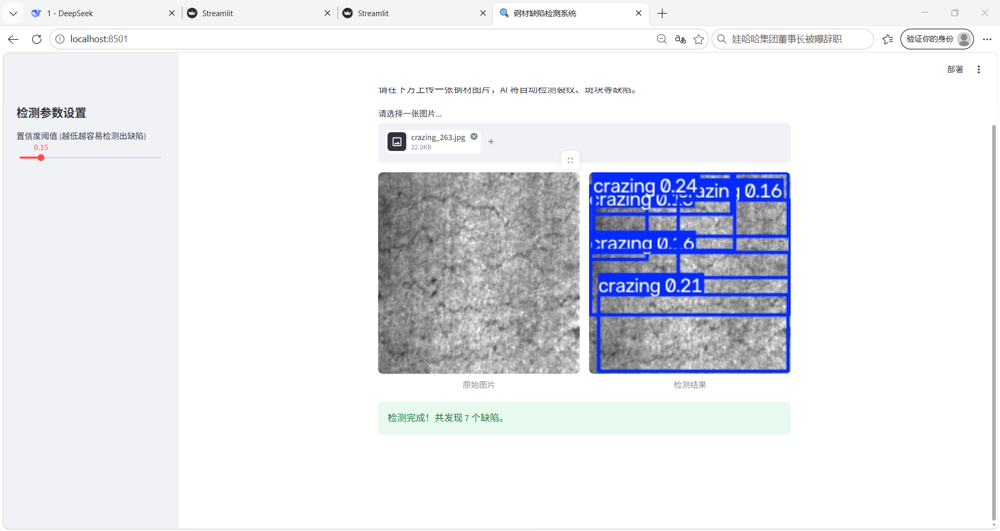

# 基于 YOLOv8 的钢材表面缺陷检测系统

🚀 **[👉 点击这里，在线体验 Web 应用](https://wayne-steel-defect.streamlit.app)**

## 📖 项目简介

本项目基于 NEU-DET 钢材表面缺陷公开数据集，使用 YOLOv8 进行六类钢材表面缺陷检测，并提供 Streamlit Web 演示界面，支持图片上传、置信度阈值调整和检测结果可视化。

项目不仅关注模型指标，还通过受控对照实验、分类别评估、错误分析和固定阈值比较，研究不同训练策略对检测性能的影响，为后续模型选择与工程验证提供依据。

## 🎯 检测类别与技术栈

### 六类钢材表面缺陷

| 类别 ID | 英文名称 | 中文名称 |
|---:|---|---|
| 0 | `crazing` | 龟裂 |
| 1 | `inclusion` | 夹杂 |
| 2 | `patches` | 斑块 |
| 3 | `pitted_surface` | 麻点 |
| 4 | `rolled-in_scale` | 氧化铁皮压入 |
| 5 | `scratches` | 划痕 |

### 项目配置

- **数据集：** NEU-DET，共 1800 张图像
- **数据划分：** 1440 张训练图像、360 张验证图像
- **主要模型：** YOLOv8n
- **主要输入尺寸：** 640 × 640
- **实验环境：** Python 3.10.11、PyTorch 2.5.1+cu121、Ultralytics 8.4.177
- **Web 技术：** Streamlit

## 📊 模型调优成果

本轮实验保留了两个用途不同的模型候选：`neu_defect_clean` 作为整体 mAP 基线，`neu_defect_mosaic000` 作为召回优先候选。

### 1. 标准验证结果

以下数据来自正式调优报告中的标准验证结果，主要输入尺寸为 640。

| 模型 | Precision | Recall | mAP@0.5 | mAP@0.5:0.95 |
|---|---:|---:|---:|---:|
| `neu_defect_clean` | 0.673 | 0.650 | **0.7281** | **0.3844** |
| `neu_defect_mosaic000` | 0.664 | **0.689** | 0.7260 | 0.3784 |

**结果解读：**

- `neu_defect_clean` 的整体 mAP 更高，保留为整体检测质量的基线。
- `neu_defect_mosaic000` 的整体 Recall 更高，在当前验证集上更适合优先考虑减少漏检的筛查场景。
- 两个模型各有取舍，不能仅凭单一指标认定某个模型全面优于另一个模型。

### 2. 模型权重下载

已将两个候选模型发布到 GitHub Releases。权重文件与代码仓库分开保存，下载后可用于本地推理或后续工程验证。

| 权重文件 | 适用方向 | Precision | Recall | mAP@0.5 | 下载 |
|---|---|---:|---:|---:|---|
| `neu_defect_clean_best.pt` | 整体检测质量基线 | 0.673 | 0.650 | **0.7281** | [下载模型](https://github.com/Wayne007X/Steel-Defect-Detection/releases/download/v1.0.0-models/neu_defect_clean_best.pt) |
| `neu_defect_mosaic000_best.pt` | 召回率优先候选 | 0.664 | **0.689** | 0.7260 | [下载模型](https://github.com/Wayne007X/Steel-Defect-Detection/releases/download/v1.0.0-models/neu_defect_mosaic000_best.pt) |

- [查看完整模型发布页（v1.0.0-models）](https://github.com/Wayne007X/Steel-Defect-Detection/releases/tag/v1.0.0-models)
- 两个模型均使用纠正后的 NEU-DET 数据集训练；以上指标来自现有验证结果，并非独立测试集结果。
- **如何选择：** 若优先考虑整体 mAP，可从 `neu_defect_clean_best.pt` 开始评估；若优先考虑减少漏检，可评估 `neu_defect_mosaic000_best.pt`。实际选择仍需结合误报成本、漏检风险和业务验证。
- 下载后请根据所使用的脚本或应用配置模型路径。当前仓库中的 Web 演示配置不代表这两个候选模型已经完成部署。

### 3. 固定阈值下的工作点比较

为进一步贴近实际推理场景，实验在相同置信度阈值和 NMS 参数下，对两个模型进行了固定工作点复核。

| 模型 | 置信度阈值 | NMS IoU | 整体 Recall |
|---|---:|---:|---:|
| `neu_defect_clean` | 0.20 | 0.30 | 0.6838 |
| `neu_defect_mosaic000` | 0.20 | 0.30 | **0.7002** |

在该工作点下，`mosaic000` 的整体 Recall 更高，但相较 `clean` 多产生了 18 个误报。龟裂类别的 Recall 也由 `clean` 的约 0.3457 提升至 `mosaic000` 的约 0.4568。

如果希望降低 `mosaic000` 在 `conf=0.20` 时的误报数量，并进一步观察 F1 表现，可以参考 `conf=0.25、NMS IoU=0.30` 的 F1 优先工作点。该点的整体 F1 约为 **0.6993**，误报数由 `conf=0.20` 时的 268 个降至 210 个。不过，同一阈值下 `mosaic000` 的误报数仍高于 `clean` 的 197 个，因此最终选择仍需结合漏检风险与误报成本。

> **注意：** 标准验证指标与固定阈值复核指标使用不同的评估口径，不应直接混用。以上数据均来自现有验证集，不代表独立测试结果。

## 🔬 模型调优过程与主要结论

本轮调优从建立基线出发，逐步开展了多组对照实验。并非每项实验都带来了提升，未通过预设验收标准的方案也保留了相应结论。

| 实验方向 | 主要结论 |
|---|---|
| Mosaic 数据增强策略 | 比较 `mosaic050` 与 `mosaic000`，当前实验条件下 `mosaic000` 的整体 Recall 更高，但不能据此断言关闭 Mosaic 在所有数据集上都更好。 |
| YOLOv8n 与 YOLOv8s | 当前配置下，YOLOv8s 未取得更好的整体 mAP，Recall 反而更低，同时模型规模和计算量更大。 |
| 输入尺寸 640 与 800 | 同一候选权重的官方验证复核未证明输入尺寸提高到 800 能带来改善，因此保留 640 作为当前主线。 |
| 分类别评估与错误分析 | 重点关注龟裂和氧化铁皮压入等薄弱类别，区分漏检、误报和不同类别之间的表现差异。 |
| 龟裂定向采样 | 未能证明该方案带来了符合预设标准的整体改善。 |
| `box=8.5` 损失权重实验 | 未通过预先设定的验收条件，不替换现有候选。 |
| 学习率约 0.0005 的实验 | 未证明能够稳定改善整体指标，不作为新的主模型。 |

### 当前阶段的主要结论

1. 保留 `neu_defect_clean` 作为整体 mAP 基线。
2. 保留 `neu_defect_mosaic000` 作为召回优先候选，建议从 `conf=0.20、NMS IoU=0.30` 开始开展受控验证。
3. 不再仅为追求某一类别的单项指标而无依据地追加训练实验。
4. 后续应结合真实业务中的误报、漏检、人工复核成本和缺陷严重程度，进一步评估候选模型。

对于工业质检场景，当前更合理的思路是采用“模型高召回筛查 + 人工或第二道检测复核 + 最终质量判定”的分层流程，而不是让模型独立决定产品放行或报废。

## 🖼️ 效果展示

### 1. 单图检测效果


### 2. Streamlit Web 界面



在线演示：[Steel Defect Detection](https://wayne-steel-defect.streamlit.app)

## 📚 实验报告与数据

为了便于复现、审查和继续开展实验，仓库保留正式调优报告、实验归档清单及相关指标文件。

- [**完整模型调优实验报告**](reports/NEU-DET_model_tuning_report_stage4.md)：记录实验过程、指标、错误分析、验收标准和最终结论。
- [实验索引](experiments/neu_det_tuning/EXPERIMENT_INDEX.md)：按实验目的、对比关系和结论定位实验，帮助区分各组候选。
- [实验归档清单](experiments/neu_det_tuning/results/artifact_manifest.csv)：查看归档实验文件及其记录信息。
- [原始实验结果目录](experiments/neu_det_tuning/results/raw_runs/)：保存训练记录、分类别指标、错误分析及其他实验结果。
- [三模型标准验证指标](deployment_model_comparison/three_model_standard_metrics.csv)：查看模型标准验证指标对照数据。

## 🛠️ 快速开始

### 1. 安装依赖

请先安装 Python 3.10，并在项目根目录执行：

```bash
python -m venv .venv
```

Windows PowerShell：

```powershell
.\.venv\Scripts\Activate.ps1
pip install -r requirements.txt
```

### 2. 启动 Web 演示

```bash
streamlit run app.py
```

本地运行时，应用会使用 `app.py` 中配置的模型权重路径。请注意，该演示配置不应被视为本轮调优候选已经完成部署。

如果要复现 `neu_defect_mosaic000` 的实验结果，需要先准备对应的 `best.pt` 权重，并根据本地配置选择正确的模型路径和验证参数。不要将不同模型的权重或不同验证工作点的指标混为一谈。

## ⚠️ 实验限制与项目状态

- **尚无独立测试集。** 当前只有训练集和验证集，模型选择与阈值比较均基于现有验证数据，可能存在对该验证集过度适配的风险。
- **实验结果不等于生产保证。** 本文指标不能直接视为独立测试成绩、真实生产线性能证明或工业质检验收结论。
- **部分类别仍存在明显挑战。** 尤其需要关注龟裂和氧化铁皮压入的漏检与误报问题。
- **当前调优已停止。** 正式报告中的主要对照、复核和归档工作已经完成，下一阶段重点转向候选模型的受控业务验证和工程部署验证。

后续若能获取独立生产批次或不同采集条件下的数据，应优先用于泛化能力评估，并根据真实业务成本确定最终模型与推理参数。
