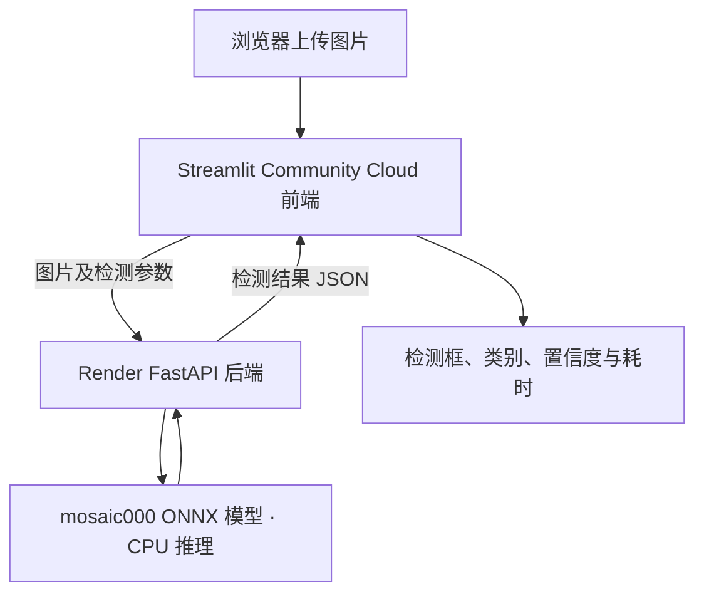

# 钢材表面缺陷检测系统：云端部署过程记录

- 整理日期：2026-10-29
- 记录范围：本次从上传项目源文件、修改 DeepSeek 开关，到 Git 推送、Render 后端部署、Streamlit 前端部署及整体验收的过程。
- 信息依据：当前聊天中提供的文件、命令输出和截图。早期模型训练和调优过程不在本文展开。

## 1. 本次目标与最终结果

本次目标是将已经能够在本地运行的钢材表面缺陷检测系统部署到云端，同时满足：

1. 本地保留 DeepSeek API 分析能力，允许按需启用。
2. 云端禁止调用 DeepSeek API，避免公开分析入口带来 Token 消耗。
3. 云端仍然能够完成图片上传、ONNX 模型推理、检测框绘制和检测信息展示。
4. 保留现有 FastAPI 后端与 Streamlit 前端结构，使用 Cursor、PowerShell 和 Git 分步操作。

最终完成了 Render 后端和 Streamlit 前端部署，并通过一次真实图片的完整网页检测。云端 `/analyze` 的禁用状态也通过实际请求验证，返回 HTTP 403。

## 2. 最终系统结构



两个平台的分工：

| 部分 | 平台 | 职责 |
|---|---|---|
| Streamlit 前端 | Streamlit Community Cloud | 上传图片、设置阈值、调用后端、展示检测结果 |
| FastAPI 后端 | Render Web Service | 加载模型、执行 CPU 推理、返回结构化结果 |
| DeepSeek 分析 | 云端关闭 | 后端拒绝分析请求，前端隐藏分析区域 |

部署 Render 并不是替代 Streamlit，而是先为 Streamlit 提供公网检测接口。保留这一结构后，前端不需要加载 PyTorch、Ultralytics 或 ONNX 模型。

后端公网地址：

<https://steel-defect-api-ud3q.onrender.com>

前端已在 `streamlit.app` 域名下成功运行。正式分享时，以 Streamlit 应用页面复制的完整地址为准。

## 3. 起点：明确需求并获取当前源文件

上传的聊天导出记录表明，之前曾把“云端不使用 DeepSeek”误解成“删除 DeepSeek 功能”。用户随后明确纠正：本地可以用，云端上线不准用。

用户也明确说明，没有执行此前删除 DeepSeek 的自动修改脚本，因此不需要恢复被删除的功能。

本次实际上传并修改的源文件：

- `onnx_inference_api_pluggable_v4.py`
- `streamlit_frontend.py`

检查源文件发现，上传的后端已经存在 `ENABLE_DEEPSEEK` 变量，但客户端创建和 `/analyze` 请求处理还没有受它控制。仅声明开关变量并不能阻止外部请求。

## 4. 修改 DeepSeek 开关

### 4.1 后端修改

开关默认关闭，只有显式配置为支持的开启值才启用：

```python
ENABLE_DEEPSEEK = os.getenv(
    "ENABLE_DEEPSEEK", "false"
).strip().lower() in {"1", "true", "yes", "on"}
```

客户端生命周期调整为：

- 启动时先将 `app.state.deepseek_client` 设为 `None`。
- 只有开关开启时，才创建 `httpx.AsyncClient`。
- 关闭时输出 `DeepSeek is DISABLED`。
- 保留已有的客户端关闭清理逻辑。

在 `/analyze` 函数读取密钥及发起外部请求之前，增加保护：

```python
if not ENABLE_DEEPSEEK:
    raise HTTPException(
        status_code=403,
        detail="DeepSeek analysis is disabled in this deployment.",
    )
```

因此，关闭开关时，即使环境中存在密钥，合法分析请求也会在调用 DeepSeek 之前被拒绝。

### 4.2 前端修改

前端使用同名、默认关闭的开关，并将以下内容放入条件控制：

- DeepSeek 分析标题和说明。
- AI 分析按钮。
- `/analyze` 请求逻辑。
- 分析结果与错误提示区域。

页面标题下方的介绍和底部提示也随开关调整，云端关闭时不再显示 AI 分析说明。

### 4.3 验证范围

交付前完成了语法检查和隔离模拟检查，包括关闭时不创建客户端、配置密钥也不能绕过保护、开启时模拟调用及客户端清理、无密钥回退和前端区域显隐。

原有 `/predict`、`/health` 和根路由函数保持不变。本次没有修改模型权重、重新训练或改变默认检测阈值。

本地 DeepSeek 功能代码保留，但本次部署流程没有执行真实 DeepSeek API 调用；不能将模拟检查写成真实联网分析已验收。

## 5. 本地启动与禁用验证

项目目录和解释器：

```text
项目：E:\yolo_project
Python：E:\yolo_workspace\Scripts\python.exe
```

本地先按云端关闭配置运行：

```powershell
$env:ENABLE_DEEPSEEK = "false"
Remove-Item Env:DEEPSEEK_API_KEY -ErrorAction SilentlyContinue
```

分别启动 FastAPI 和 Streamlit。页面成功连接后端，能够上传图片并显示检测框，同时隐藏 DeepSeek 分析区域。

随后绕过前端，向本地 `/analyze` 发送符合接口结构的 JSON，得到：

```text
HTTP: 403
BODY: {"detail":"DeepSeek analysis is disabled in this deployment."}
PASS: backend blocks DeepSeek analysis.
```

这一步验证的是后端实际拒绝请求，而不只是前端按钮不可见。

## 6. 核对依赖并准备部署模型

### 6.1 本地环境记录

| 组件 | 用户终端记录版本 |
|---|---|
| Python | 3.10.11 |
| FastAPI | 0.162.0 |
| Uvicorn | 0.54.0 |
| python-multipart | 0.0.32 |
| Pillow | 12.3.0 |
| httpx | 0.28.1 |
| NumPy | 2.2.6 |
| ONNX Runtime | 1.23.2 |
| Ultralytics | 8.4.177 |
| PyTorch | 2.5.1+cu121 |
| torchvision | 0.20.1+cu121 |
| opencv-python | 5.0.0.93 |
| Streamlit | 1.65.0 |
| requests | 2.34.2 |

原来的 `txt/requirements_api_v4.txt` 只包含 API 侧部分依赖，注释也说明不重装已有的核心推理组件。它适用于已有环境，不能单独作为空白云端环境的完整依赖清单。

尽管模型格式为 ONNX，当前后端仍通过 `ultralytics.YOLO` 调用，因此部署时保留了 Ultralytics 和 CPU 版 PyTorch。

### 6.2 新增后端云端依赖

新增 `txt/requirements_api_cloud.txt`：

```text
# CPU builds for cloud deployment
--extra-index-url https://download.pytorch.org/whl/cpu
torch==2.5.1+cpu
torchvision==0.20.1+cpu

# Versions recorded from the working local environment
fastapi==0.162.0
uvicorn==0.54.0
python-multipart==0.0.32
Pillow==12.3.0
httpx==0.28.1
numpy==2.2.6
onnxruntime==1.23.2
ultralytics==8.4.177
opencv-python==5.0.0.93
```

这是直接依赖版本记录，并非完整的传递依赖锁文件。

### 6.3 复制并核对模型

| 用途 | 路径 |
|---|---|
| 原模型 | `E:\yolo_project\runs\neu_defect_mosaic000\weights\best.onnx` |
| 部署副本 | `E:\yolo_project\models\mosaic000.onnx` |
| 云端相对路径 | `models/mosaic000.onnx` |

文件大小为 `12,751,171` 字节，约 `12.16 MiB`。源文件与部署副本 SHA256 完全一致：

```text
95F2EDB3735C896A8F83ECBA12E7D466582984CC87B1EE88C4216C84F3C5BA98
```

复制只是改变部署位置和文件名，没有重新导出或修改模型。

### 6.4 处理 Git 忽略规则

检查发现 `.gitignore` 中的 `*.onnx` 忽略了模型。新增精确例外：

```gitignore
# ONNX model used by the cloud API
!/models/mosaic000.onnx
```

随后 Git 能识别 `models/mosaic000.onnx`。没有解除所有 ONNX 文件的忽略规则。

将本地后端的 `MODEL_PATH` 改为部署副本后重新启动，日志确认模型成功加载、使用 `CPUExecutionProvider` 完成预热，且 DeepSeek 关闭。

## 7. Git 提交和推送

仓库：<https://github.com/Wayne007X/Steel-Defect-Detection>

分支：`main`。

### 第一次提交：后端部署材料和功能开关

```text
f147b1c Prepare CPU ONNX cloud deployment and gate DeepSeek analysis
```

提交了 5 个文件：

1. `.gitignore`
2. `models/mosaic000.onnx`
3. `onnx_inference_api_pluggable_v4.py`
4. `streamlit_frontend.py`
5. `txt/requirements_api_cloud.txt`

终端确认已成功推送到 `origin/main`。

### 第二次提交：Streamlit 自动识别的依赖文件

```text
3f773ff Add Streamlit Cloud frontend dependencies
```

新增仓库根目录 `requirements.txt`：

```text
streamlit==1.65.0
requests==2.34.2
Pillow==12.3.0
```

Streamlit 前端入口在根目录，新增该标准文件名让平台自动识别依赖。后端仍通过明确的构建命令使用 `txt/requirements_api_cloud.txt`。

本次未将 README 删除、DNS 文档和 `backups/` 等无关改动一起提交。

## 8. Render 后端部署

按 Python Web Service 方式连接 GitHub 仓库，并使用以下配置：

| 配置项 | 本次使用或给定的配置 |
|---|---|
| Repository | `Wayne007X/Steel-Defect-Detection` |
| Branch | `main` |
| Runtime | Python 3 |
| Root Directory | 留空 |
| Build Command | `pip install -r txt/requirements_api_cloud.txt` |
| Start Command | `python -m uvicorn onnx_inference_api_pluggable_v4:app --host 0.0.0.0 --port $PORT --workers 1` |
| Health Check Path | `/health` |

云端环境变量按以下值配置：

```text
PYTHON_VERSION=3.10.11
MODEL_PATH=models/mosaic000.onnx
ENABLE_DEEPSEEK=false
YOLO_AUTOINSTALL=false
CUDA_VISIBLE_DEVICES=-1
```

不配置 `DEEPSEEK_API_KEY`。

截图显示首轮部署状态为 `Deploy succeeded`，源提交为 `f147b1c`，部署时长约 `3 分 27 秒`；日志中的 `/health` 持续返回 HTTP 200。

地区选择过程中解释了 Oregon 与 Singapore 的位置，但当前截图没有确认最终选定地区。实例规格也没有在当前材料中明确确认。

## 9. 云端接口验收

使用本地 Python 请求公网后端，依次验证 `/health`、`/predict` 和 `/analyze`。

测试图片：`E:\yolo_project\picture\crazing_252.jpg`。

检测参数：`conf=0.25`、`iou=0.70`、`imgsz=640`。

| 测试项 | 实际结果 |
|---|---|
| `/health` | `status=ok`，模型 `mosaic000`，设备 `cpu` |
| `/predict` | HTTP 200，返回 2 个龟裂框 |
| 后端处理耗时 | `6254.224 ms` |
| `/analyze` | HTTP 403，返回部署禁用提示 |

两个检测框记录：

| 类别 | 置信度 | 原图坐标 `[x1, y1, x2, y2]` |
|---|---:|---|
| crazing | 0.433809 | `[24.77, 115.2, 196.96, 187.07]` |
| crazing | 0.425217 | `[0.7, 0.04, 155.32, 57.04]` |

这与聊天导出中记录的本地同图结果一致，说明该样本的云端输出没有因部署而出现明显变化。

根路由仍显示 `analyze: POST /analyze`，只是保留路由说明；路由是否允许调用，以实际请求结果为准。本次有效请求返回了 403。

## 10. Streamlit 前端部署

应用列表最初已有一个入口为 `app.py` 的旧应用。指导保留旧应用，以这次新的前端入口部署，避免混淆旧版界面和新版 FastAPI 前端。

部署配置：

| 配置项 | 内容 |
|---|---|
| Repository | `Wayne007X/Steel-Defect-Detection` |
| Branch | `main` |
| Main file path | `streamlit_frontend.py` |
| Python | 指导选择 3.12；截图未单独展示最终版本设置 |

在 Advanced settings 的 Secrets 中配置顶层键：

```toml
FASTAPI_BASE_URL = "https://steel-defect-api-ud3q.onrender.com"
ENABLE_DEEPSEEK = "false"
```

前端启动后的截图确认：

- 页面在 `streamlit.app` 公网域名下运行。
- FastAPI 地址指向 Render 公网服务。
- 侧栏显示“FastAPI 已连接”。
- 模型为 `mosaic000`，设备为 `cpu`。
- DeepSeek 分析入口隐藏。

## 11. 最终网页整体验收

在云端网页上传 `crazing_252.jpg`，保持阈值不变，再执行视觉检测。

| 项目 | 页面实际显示 |
|---|---|
| 模型 | `mosaic000` |
| 图片尺寸 | `200 × 200` |
| 检测框数量 | 2 |
| 类别 | `crazing` |
| 显示置信度 | 约 0.425、0.434 |
| 后端处理耗时 | 约 `5589.7 ms` |
| 置信度阈值 | 0.25 |
| NMS IoU | 0.70 |

网页成功显示两个检测框、类别、置信度、数量和耗时。至此，浏览器上传、前端请求、公网后端推理和结果展示的完整链路通过验收。

这里的约 5.59 秒是接口返回的后端处理耗时，不等于完整网页请求总耗时，也不能用单次结果代表平均性能。

## 12. 过程中遇到的问题和处理方法

| 问题或易混淆点 | 处理方法与结论 |
|---|---|
| 把云端禁用理解成删除 DeepSeek | 明确本地保留、云端默认关闭，保留代码并增加开关保护 |
| 已声明开关但没有约束调用 | 将客户端创建和分析函数实际接入开关 |
| 只隐藏按钮不足以禁用 API | 本地和云端均直接请求 `/analyze`，验证 403 |
| 原依赖文件缺少推理组件 | 新增完整的后端云端依赖文件，使用 CPU 版 PyTorch |
| 模型在 `runs/`，且被忽略 | 复制到 `models/`，核对哈希，并增加精确 Git 例外 |
| Git 输出停留在 `:` | 退出分页器，使用 `git --no-pager diff` 查看完整差异 |
| LF 转 CRLF 警告 | 确认是换行符提示，不当作提交失败；提交、推送实际成功 |
| 为什么先部署 Render | 说明 Render 承担后端，Streamlit 平台承担前端 |
| 旧 Streamlit 应用入口为 `app.py` | 使用本次的 `streamlit_frontend.py` 入口，避免误部署旧页面 |
| 前端依赖文件名不被自动识别 | 在仓库根目录新增 `requirements.txt` |
| 根路由仍列出 `/analyze` | 以实际 POST 请求的 403 判断禁用，不靠路由名称推断 |

本次最初交付 Python 修改文件时，持久保存尝试失败，之后提供了工作区下载文件。后续用户已将修改保存到本地项目并推送 GitHub，项目代码以仓库提交为可追溯依据。

## 13. 当前结论和验证边界

### 已经确认

- 云端 FastAPI 后端部署成功，ONNX 模型可以执行 CPU 推理。
- 云端 Streamlit 前端成功连接后端并展示真实图片检测结果。
- 云端分析接口拒绝合法分析请求，返回明确的 403 禁用提示。
- 本地 DeepSeek 功能代码保留，可通过开关和后端密钥配置启用。
- 两次指定文件提交均已成功推送 GitHub。

### 尚未完成或不能由本次结果推出

- 没有在本次流程中验收真实 DeepSeek 联网分析。
- 没有完成六类缺陷的大规模网页回归测试。
- 没有进行并发、长时间运行、冷启动或性能分布测试。
- 单张图片检出两个框，不等于模型整体精度、召回率或 mAP 已重新评估。
- 本次完成的是功能部署与链路验收，未新增接口鉴权或限流机制。
- 曾建议关闭本地前后端后再刷新云端测试；当前没有对应的后续截图或输出，不能记录为已执行。

## 14. 下一步建议

1. 关闭本地 FastAPI 和 Streamlit，再测试一次云端网页，补充独立运行验证记录。
2. 选取六类缺陷的代表图片，检查正常检出、无检测框和不同阈值下的页面表现。
3. 记录多次推理耗时，区分后端处理时间与浏览器等待时间，评估是否需要优化计算资源。
4. 将部署配置、前后端地址、测试样例和 Git 提交号整理到正式项目说明中。
5. 根据网站实际分享范围，再决定是否增加访问控制、限流和页面体验改进。

本次成果是：在保留本地可选 DeepSeek 能力的前提下，完成了云端禁用 DeepSeek 的钢材缺陷检测网站部署，并通过真实图片的前后端完整链路测试。
