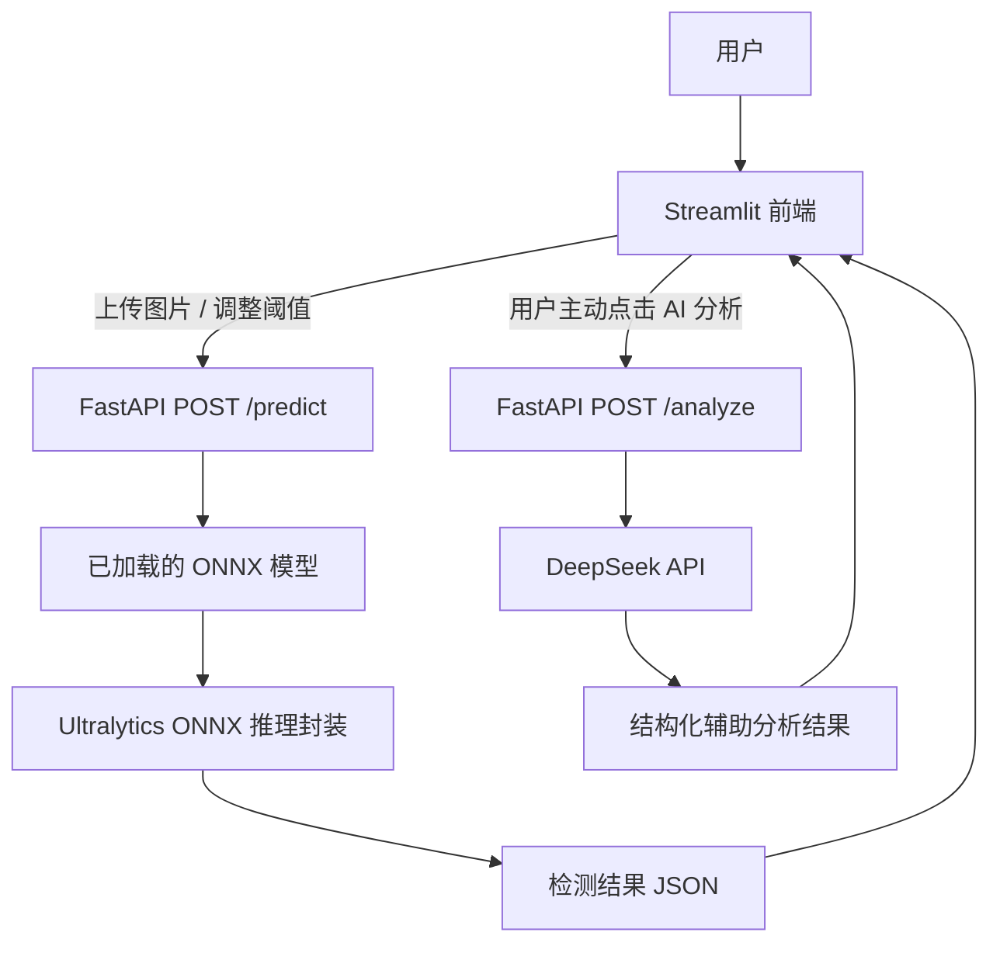

# 钢材表面缺陷检测系统：四阶段完整项目记录与使用手册

> **文档目的**：完整记录本项目从 ONNX 模型部署到 FastAPI、DeepSeek
> 辅助分析、Streamlit
> 前端及端到端回归测试的架构、实施过程、实际测试结果、启动命令、使用方法、问题处理与当前结论。
>
> **记录范围**：依据当前聊天中提供的命令、终端日志、测试输出、前端截图，以及附件《极其重要的思路设计.docx》整理。凡是没有实际日志或截图证明的事项，均标注为"待验证"或"设计建议"，不将其写成已完成事实。

------------------------------------------------------------------------

## 目录

1.  [项目目标与总体结论](#1-项目目标与总体结论)
2.  [系统总体架构](#2-系统总体架构)
3.  [技术设计原则与关键取舍](#3-技术设计原则与关键取舍)
4.  [第一阶段：FastAPI 与 ONNX
    视觉推理接口](#4-第一阶段fastapi-与-onnx-视觉推理接口)
5.  [第二阶段：DeepSeek 辅助分析接口](#5-第二阶段deepseek-辅助分析接口)
6.  [第三阶段：Streamlit 前端](#6-第三阶段streamlit-前端)
7.  [第四阶段：端到端回归测试](#7-第四阶段端到端回归测试)
8.  [重要问题的排查过程](#8-重要问题的排查过程)
9.  [推荐启动流程与命令](#9-推荐启动流程与命令)
10. [切换 ONNX 模型的方法](#10-切换-onnx-模型的方法)
11. [日常使用流程](#11-日常使用流程)
12. [测试结果汇总](#12-测试结果汇总)
13. [已知限制与仍需补充的验证](#13-已知限制与仍需补充的验证)
14. [交付与备份清单](#14-交付与备份清单)
15. [项目小结](#15-项目小结)

------------------------------------------------------------------------

## 1. 项目目标与总体结论

### 1.1 项目目标

构建一个可以在本地交互使用的钢材表面缺陷检测系统。用户上传钢材表面图片后，系统使用
YOLO 系列模型导出的 ONNX 文件进行视觉检测，通过 Web
页面展示检测框、缺陷类别、置信度和推理耗时，并允许用户单独请求 DeepSeek
对检测器输出的结构化数据进行辅助解释。

系统当前涉及六类缺陷：

    类别 ID 类别名称
  --------- -------------------
          0 `crazing`
          1 `inclusion`
          2 `patches`
          3 `pitted_surface`
          4 `rolled-in_scale`
          5 `scratches`

### 1.2 当前结论

根据当前聊天中的实际测试输出与页面截图，以下主要功能已经实现并得到验证：

-   FastAPI 可以加载配置的 ONNX 模型并提供
    `/health`、`/predict`、`/analyze` 接口。
-   `/predict`
    能返回检测数量、类别、置信度、原图坐标系中的检测框等结果。
-   对空文件、无法解码的非图片文件、超大图片和非法置信度参数，接口会返回相应
    HTTP 错误。
-   `mosaic000` 与 `clean` 两个模型配置都进行过接口测试。
-   Streamlit 页面可以连接
    FastAPI，展示上传图片的检测框、类别、置信度、图片尺寸、推理耗时及检测概览。
-   前端已实际显示 DeepSeek
    辅助分析成功的结果，包括检测概览、结果解读和建议复核内容。
-   CPU 修复版启动日志显示 ONNX 后端完成 CPU warm-up，推理设备明确设置为
    CPU。

**当前推荐的稳定运行方式：以 `mosaic000` 为默认模型，使用 CPU
推理，视觉检测与 AI 分析分开调用。**

这代表本地主要功能链路已跑通，不代表已经完成生产环境部署、工业现场验收、并发压力测试或所有边界条件测试。

------------------------------------------------------------------------

## 2. 系统总体架构

### 2.1 架构图



### 2.2 三个主要部分

#### A. Streamlit 前端

负责与用户交互：

-   上传图片；
-   填写 FastAPI 地址；
-   调整置信度阈值（confidence threshold）；
-   调整 NMS IoU 阈值；
-   展示检测框、缺陷类别、置信度、检测数量、模型名称、图片尺寸和耗时；
-   展示完整检测数据及原始 `/predict` JSON；
-   通过独立按钮请求 DeepSeek 辅助分析；
-   显示 AI 分析状态、分析内容和接口耗时。

前端不应重复加载 ONNX 模型。模型路径和推理过程由 FastAPI 后端负责。

#### B. FastAPI 后端

负责视觉推理和接口管理：

-   服务启动时加载配置的 ONNX 模型；
-   提供 `/health`，用于查看服务、模型和类别配置；
-   提供 `/predict`，执行视觉推理并返回结构化检测结果；
-   提供 `/analyze`，将检测器返回的结构化数据交给 DeepSeek
    生成辅助说明；
-   校验图片与参数；
-   在 AI 分析失败或不可用时，尽量保留视觉检测能力；
-   通过环境变量选择模型路径与模型标签。

当前测试中，FastAPI 在本机 `127.0.0.1` 上运行，最终前端截图使用的 API
地址是 `http://127.0.0.1:8001`。

#### C. ONNX 推理与 Ultralytics 封装

模型文件示例：

-   `E:\yolo_project\runs\neu_defect_mosaic000\weights\best.onnx`
-   `E:\yolo_project\runs\neu_defect_clean\weights\best.onnx`

设计思路是使用 Ultralytics 对 ONNX
的推理封装，尽量沿用其预处理、尺寸处理、检测框解码和 NMS
等流程，而不是另写一套不一致的原始 ONNX Runtime
后处理。这样更有利于保持已有模型推理行为的一致性。

当前服务实际报告的运行设备为 `cpu`。日志中的可用 ONNX Runtime providers
为 `AzureExecutionProvider` 和 `CPUExecutionProvider`，没有显示
`CUDAExecutionProvider`。

### 2.3 为什么视觉检测和 AI 分析要拆成两个接口

两个接口的职责不同：

  接口              任务                   是否依赖 DeepSeek
  ----------------- ---------------------- -------------------
  `POST /predict`   图片视觉检测           否
  `POST /analyze`   对检测结果做语言分析   是

拆分后的优点：

1.  DeepSeek 响应慢时，视觉检测不必等待 AI 分析。
2.  DeepSeek 未配置、超时或不可用时，用户仍然可以获得检测结果。
3.  前端可以先显示检测结果，再由用户主动请求 AI 分析。
4.  AI 结果属于辅助解释，不会直接覆盖检测器的原始输出。

### 2.4 一次完整请求的流程

1.  用户在 Streamlit 上传图片。
2.  Streamlit 将图片和阈值等参数发送给 FastAPI 的 `/predict`。
3.  FastAPI 校验输入，并调用已加载的 ONNX 推理模型。
4.  后端返回检测框、类别、置信度、图片尺寸、模型名称和耗时等信息。
5.  Streamlit 根据返回的原图像素坐标绘制检测框，并展示检测概览。
6.  用户如果需要解释，可以点击"生成 AI 辅助分析"。
7.  Streamlit 将检测器的结构化结果提交给 `/analyze`。
8.  `/analyze` 调用 DeepSeek 并返回辅助说明；如果 AI
    不可用，应展示明确状态，而不应让已经得到的视觉检测结果消失。

**重要边界：** 当前页面提示 DeepSeek
分析的是检测器返回的结构化数据，不会直接查看原始图片。因此 AI
对缺陷形态的解释不能视为直接图像判读，也不能替代人工质检。

------------------------------------------------------------------------

## 3. 技术设计原则与关键取舍

附件《极其重要的思路设计.docx》中强调了以下设计方向，当前项目也按这些方向推进。

### 3.1 模型启动时加载，不要每次请求都重新加载

模型加载通常比单次推理更耗时。目标是在 FastAPI
启动阶段完成模型加载并复用模型对象，避免每次请求重新创建模型。

模型路径通过 `MODEL_PATH` 配置，模型标签通过 `MODEL_NAME`
配置。切换配置后通常需要重启
FastAPI，不能假定已启动的服务会自动热切换到新模型。

### 3.2 避免共享推理对象被并发请求不安全地使用

设计文档提到通过锁保护共享的 Ultralytics
推理对象，避免多个请求同时操作同一预测器造成冲突。后续如果提高并发量，应专门进行并发测试，不能仅凭单请求成功就推断高并发安全。

### 3.3 DeepSeek 不应该成为视觉检测的前置依赖

视觉检测是核心功能，AI 分析是辅助功能。两者应独立请求，并为 AI
调用设置超时、异常处理和清晰的失败状态。

当前实际验证过： - 未配置 `DEEPSEEK_API_KEY` 时，`/analyze` 返回
`status=unavailable` 及说明信息； - `/analyze` 的降级响应后，继续调用
`/predict` 仍返回 HTTP 200； - 后续 Streamlit 截图显示 AI 分析成功返回。

真实网络超时或服务端异常的每一种情况，仍应以专门的故障注入测试为准。

### 3.4 图片在内存中处理，并限制上传大小

测试结果显示：

-   空文件：HTTP 400；
-   无法解码的非图片文件：HTTP 400；
-   超过 10 MiB 的图片：HTTP 413。

这有助于避免无效输入进入模型推理流程。测试并不能代替完整的安全审计。

### 3.5 统一并稳定 API 的 JSON 契约

测试脚本已检查 `/predict` 返回结构中所需字段是否缺失，结果为
`missing=[]`。返回结果包含模型标签、文件名、图片尺寸、推理设置、检测数量、耗时、坐标系说明和检测条目等信息。

附件设计文档提出使用 Pydantic `response_model`
严格定义输出结构，以提升接口稳定性。当前聊天没有提供足够证据确认所有响应模型都已通过
Pydantic
严格声明，因此这项可以作为后续代码审查项，而不是直接认定已完成。

### 3.6 CPU 与 GPU 的取舍

目前服务的实际 provider 列表没有
`CUDAExecutionProvider`，推理日志显示使用 CPU。项目曾出现 Ultralytics
自动尝试安装 `onnxruntime-gpu` 的情况，安装失败原因包括 Windows
`WinError 5`（DLL 拒绝访问/文件正在使用）。

当前没有充分证据证明 GPU
版已经在本项目环境中成功启用。因此目前优先保留已验证的 CPU
运行方式，而不是为了"理论上更快"强行安装 GPU 版。

------------------------------------------------------------------------

## 4. 第一阶段：FastAPI 与 ONNX 视觉推理接口

### 4.1 阶段目标

将训练好的 ONNX 模型封装成独立 HTTP
服务，使前端或测试脚本不需要直接加载模型，也可以提交图片并获得标准化检测结果。

### 4.2 已完成的主要工作

-   FastAPI 服务可以启动；
-   服务启动阶段可以加载指定的 ONNX 文件；
-   `/health` 可以报告服务状态、模型标签、设备、输入尺寸和类别名称；
-   `/predict` 可以接收图片并返回检测结果；
-   返回的坐标明确为原始上传图片上的 `xyxy` 像素坐标；
-   对图片输入和置信度参数进行了错误处理；
-   使用测试脚本验证接口响应契约、类别映射、坐标范围和置信度范围。

### 4.3 `/health` 的实际结果

在 `mosaic000` 配置下，实际响应包含：

``` json
{
  "status": "ok",
  "model": "mosaic000",
  "device": "cpu",
  "imgsz": 640,
  "class_names": {
    "0": "crazing",
    "1": "inclusion",
    "2": "patches",
    "3": "pitted_surface",
    "4": "rolled-in_scale",
    "5": "scratches"
  },
  "onnxruntime_providers_available": [
    "AzureExecutionProvider",
    "CPUExecutionProvider"
  ]
}
```

### 4.4 `/predict` 的实际检测样例

测试图片：

`D:\yolov8\NEU-DET\validation\images\crazing\crazing_253.jpg`

图片尺寸：`200 × 200`。

`mosaic000` 的一次测试结果：

-   检测数量：2；
-   类别均为 `crazing`；
-   检测 1 置信度约为 `0.546265`；
-   检测 1 框：`x1=34.21, y1=85.65, x2=169.38, y2=177.03`；
-   检测 2 置信度约为 `0.266782`；
-   检测 2 框：`x1=81.76, y1=0.0, x2=173.36, y2=45.5`。

接口测试中的处理耗时曾记录为约 25--40
ms（热运行测试）。具体耗时会受模型预热、机器负载、运行环境和请求过程影响，不能将单次记录当作固定性能指标。

### 4.5 输入异常测试

  场景                 实际结果
  -------------------- -------------------------------------
  空上传文件           HTTP 400，提示上传文件为空
  非图片文件           HTTP 400，提示无法解码为图片
  超过 10 MiB 的图片   HTTP 413，提示最大上传大小为 10 MiB
  非法置信度阈值       HTTP 422

### 4.6 第一阶段结论

**FastAPI 视觉推理接口的主要功能已通过实际接口测试。** 这一阶段没有要求
Streamlit 参与，因此可以独立验证模型接口本身是否正确工作。

------------------------------------------------------------------------

## 5. 第二阶段：DeepSeek 辅助分析接口

### 5.1 阶段目标

在视觉检测之外，增加自然语言辅助解释。DeepSeek
接收的是检测器的结构化结果，而不是直接替代 ONNX 模型进行缺陷检测。

### 5.2 设计与使用方式

-   独立使用 `POST /analyze`；
-   API Key 通过 `DEEPSEEK_API_KEY` 环境变量配置；
-   AI 分析不应成为 `/predict` 的前置步骤；
-   对未配置密钥、超时或请求异常，应返回明确的不可用状态或错误信息；
-   AI 输出只作为辅助复核参考。

### 5.3 已验证的降级行为

在一次 `--test-analyze` 测试中，后端没有配置
`DEEPSEEK_API_KEY`。测试输出为：

``` text
PASS | POST /analyze returns a structured success/fallback response
HTTP 200
status=unavailable
message=未配置 DEEPSEEK_API_KEY，已跳过 AI 分析；视觉检测结果仍可用。
PASS | /predict remains available after /analyze
HTTP 200
```

这证明：**在该测试配置下，AI 分析不可用时，视觉检测接口仍然可用。**

注意：这个测试验证的是未配置 API Key 时的降级路径，不是 DeepSeek
实际在线调用成功的证据。

### 5.4 已验证的真实 AI 分析

后续 Streamlit 页面截图显示：

-   AI 分析状态为"AI 分析完成"；
-   返回"检测概览""结果解读""建议复核"等结构化内容；
-   页面显示 AI 接口耗时约 `3406 ms`（另一次截图显示约 `3694 ms`）。

这些页面结果证明，在当时运行环境与配置下，前端成功取得了 AI 分析结果。

### 5.5 AI 输出的边界

AI 可以帮助组织检测信息、解释置信度和提醒人工复核，但不能：

-   把模型置信度直接解释为缺陷真实存在的概率；
-   在没有查看原始图片的情况下确认检测框内的真实表面形态；
-   单独决定缺陷严重程度、质量等级或是否报废；
-   替代人工质检、经验证的业务规则或安全控制逻辑。

------------------------------------------------------------------------

## 6. 第三阶段：Streamlit 前端

### 6.1 阶段目标

让用户通过浏览器操作系统，不必手动构造 HTTP
请求，也不必直接操作模型文件。

### 6.2 页面已展示的功能

当前聊天提供的页面截图显示：

-   左侧配置 FastAPI 地址；
-   调整置信度阈值和 NMS IoU 阈值；
-   显示 FastAPI 已连接状态；
-   显示当前模型标签和设备；
-   展示视觉检测结果、检测框、缺陷类别、置信度、图片尺寸与推理耗时；
-   展开查看完整检测数据和原始 `/predict` JSON；
-   点击"生成 AI 辅助分析"后展示分析状态、检测概览、结果解读和建议复核。

### 6.3 已见到的界面结果

`mosaic000` 在 `crazing_253.jpg` 上的页面截图显示：

-   图片尺寸 `200 × 200`；
-   检测到 2 个 `crazing`；
-   置信度约为 `0.546` 和 `0.267`；
-   页面显示模型标签"马赛克0000"（这是 UI 的显示文本；API 返回标签为
    `mosaic000`）；
-   一次前端截图中的推理耗时约为
    `221.5 ms`，另一张截图中曾显示更长耗时，可能包含首次推理或不同运行状态的开销。

`clean` 模型的页面截图显示：

-   检测到 1 个 `crazing`；
-   置信度约为 `0.470`；
-   检测框贴近图像上边缘。

检测框是否真实对应缺陷，仍应对照原图人工确认，尤其是贴近图像边缘的框。

### 6.4 前端与后端的连接关系

最终页面截图中，左侧 FastAPI 地址为：

`http://127.0.0.1:8001`

因此本文后续统一用 `8001` 作为推荐示例端口。前端地址必须与实际 FastAPI
端口一致。

### 6.5 第三阶段结论

**Streamlit 已能作为交互前端连接后端，显示视觉检测结果，并单独展示 AI
辅助分析。** 已验证模块不应为了整理项目而随意重写。

------------------------------------------------------------------------

## 7. 第四阶段：端到端回归测试

### 7.1 阶段目标

在不大规模修改正常运行模块的前提下，验证各组件能否一起工作，并记录哪些环节已经验证、哪些仍需补充。

### 7.2 测试工具

当前项目目录中使用的测试脚本：

`E:\yolo_project\verify_fastapi_live.py`

它会向正在运行的 FastAPI
发请求，检查健康状态、模型标签、检测结果结构、类别、坐标、置信度和异常输入。加上
`--test-analyze` 后，还会调用 `/analyze`，可能消耗 DeepSeek API 额度。

### 7.3 `mosaic000` 常规测试：14/14 通过

实际输出包含以下通过项：

-   `/health` 返回 HTTP 200 且 `status=ok`；
-   模型标签符合预期；
-   `/health` 返回 6 个类别；
-   `/predict` 返回 HTTP 200；
-   返回 JSON 契约所需字段齐全；
-   图片尺寸与上传图片一致；
-   检测数量等于检测条目数量；
-   所有检测框是有效的原图 `xyxy` 坐标；
-   类别 ID 与 `/health` 中的类别名称一致；
-   所有置信度均处于 0 到 1 之间；
-   空文件、非图片、超大图片和非法置信度参数得到预期错误码。

汇总：

``` text
LIVE SMOKE TEST SUMMARY: 14/14 passed; 0 failed
```

### 7.4 `mosaic000` 包含 `/analyze` 降级路径的测试：16/16 通过

在没有配置 `DEEPSEEK_API_KEY` 的那次测试中：

-   `/analyze` 返回结构化的不可用/降级响应；
-   `/predict` 在 `/analyze` 之后仍然返回 HTTP 200。

汇总：

``` text
LIVE SMOKE TEST SUMMARY: 16/16 passed; 0 failed
```

这证明该测试中的降级路径工作正常，不等同于真实网络超时已经完全覆盖。

### 7.5 `clean` 模型测试

先将后端切换到 `clean` 后，第一次直接使用测试脚本的默认预期模型名
`mosaic000`，因此出现一项失败：

``` text
FAIL | configured model label matches expectation
expected=mosaic000; actual=clean
```

这不是视觉推理失败，而是测试脚本仍按默认模型标签进行断言。

之后使用正确的参数重新运行：

``` powershell
python .\verify_fastapi_live.py "D:\yolov8\NEU-DET\validation\images\crazing\crazing_253.jpg" --expected-model clean
```

结果：

``` text
LIVE SMOKE TEST SUMMARY: 14/14 passed; 0 failed
```

这次测试确认了 `clean` 配置的接口响应符合测试预期。

### 7.6 端到端测试的边界

目前已经有接口测试和前端截图支持主要链路正常，但以下内容仍需要单独验证：

-   多类别、多图片、不同分辨率和无检测目标图片；
-   DeepSeek 真正发生网络超时或连接失败时的表现；
-   Streamlit 与 FastAPI 连续运行较长时间后的稳定性；
-   并发请求与压力测试；
-   在前端完成 `clean` 与 `mosaic000` 的完整切换演示；
-   工业现场或生产环境部署。

------------------------------------------------------------------------

## 8. 重要问题的排查过程

### 8.1 测试图片路径错误

最初测试时，脚本报告：

``` text
FAIL | test image not found: D:\yolov8\NEU-DET\validation\images\crazing\crazing_253.jpg
```

后续使用该路径重新运行并成功通过测试。因此在执行命令前应确认测试图片路径确实存在。

### 8.2 `/health` 请求超时

曾出现：

``` text
Read timed out. (read timeout=5)
```

之后检查服务日志，看到模型加载、依赖自动安装尝试和 CPU fallback
等信息。最终在服务成功启动并稳定响应后，`/health` 返回了预期的 JSON。

排查原则：

1.  确认 FastAPI 终端没有退出；
2.  确认请求端口与服务端口一致；
3.  查看服务启动日志是否完成；
4.  不要在同一个端口上误启动多个服务；
5.  如果模型加载或依赖处理卡住，先记录日志再处理，不要反复同时启动多个实例。

### 8.3 Ultralytics 反复尝试安装 `onnxruntime-gpu`

曾出现自动安装 `onnxruntime-gpu` 的尝试，并因以下错误失败：

``` text
OSError: [WinError 5] 拒绝访问:
'E:\yolo_workspace\Lib\site-packages\onnxruntime\capi\onnxruntime_providers_shared.dll'
```

日志之后显示：

``` text
Using ONNX Runtime 1.23.2 with CPUExecutionProvider
WARNING CUDA requested but CUDAExecutionProvider not available. Using CPU...
```

当时的实际环境只报告 `AzureExecutionProvider` 与
`CPUExecutionProvider`，没有
`CUDAExecutionProvider`。因此安装过程没有成功启用
GPU，反而产生重复下载、DLL 占用和启动延迟问题。

之后使用的 CPU 修复版启动日志显示：

``` text
[startup] ONNX model wrapper created.
[startup] ONNX Runtime providers available: ['AzureExecutionProvider', 'CPUExecutionProvider']
[startup] Initializing ONNX backend with CPU warm-up...
Using ONNX Runtime 1.23.2 with CPUExecutionProvider
[startup] ONNX backend initialized and warmed up.
[startup] Inference device is explicitly set to CPU.
```

这证明该次启动明确使用 CPU
并完成预热。后续若仍出现自动安装提示，应确认启动的是修复后的 API
模块，而不是旧入口文件。

**当前策略：不为了启用 GPU 而强行安装 GPU 运行时。先保持已验证的 CPU
版本稳定运行；如将来确实需要 GPU，再单独评估驱动、CUDA、cuDNN、ONNX
Runtime 版本兼容性与实际性能。**

### 8.4 测试模型名称不匹配

`verify_fastapi_live.py` 中默认参数为：

``` python
parser.add_argument(
    "--expected-model",
    default="mosaic000",
    help="Expected model label from /health"
)
```

切换到 `clean` 后，如果不传
`--expected-model clean`，测试会因为标签断言不匹配而失败。解决办法是把测试预期标签设置为实际运行的模型标签。

### 8.5 Streamlit 未启动

FastAPI 和 Streamlit 是两个独立进程。FastAPI
启动成功，不代表浏览器前端会自动出现。

正确做法是： - 一个终端保持 FastAPI 运行； - 另开一个终端启动
Streamlit； - 浏览器访问 `http://localhost:8501`； - 在前端左侧填写与
FastAPI 实际监听端口一致的地址。

### 8.6 `GET /json/version` 返回 404

启动日志中曾出现：

``` text
GET /json/version HTTP/1.1" 404 Not Found
GET / HTTP/1.1" 200 OK
```

`/json/version` 并不是本项目已验证的业务接口。单独看到这一条 404
不能证明 `/health` 或 `/predict`
有故障；应以实际业务接口的健康检查与回归测试结果为准。

------------------------------------------------------------------------

## 9. 推荐启动流程与命令

### 9.1 当前推荐的端口安排

  组件        地址/端口
  ----------- --------------------------------
  FastAPI     `http://127.0.0.1:8001`
  Streamlit   `http://localhost:8501`
  健康检查    `http://127.0.0.1:8001/health`

统一使用 `8001`
的原因是：当前聊天中的最终前端截图与后续测试命令均使用了该端口。若本机实际运行在其他端口，应同步修改前端地址和测试参数。

### 9.2 启动前确认 API 文件名

项目经历过多个 API 版本。CPU 修复工作对应的是 `v4`
方向，但启动前应以本机实际存在且已经验证的文件为准。可以执行：

``` powershell
cd E:\yolo_project
Get-ChildItem .\onnx_inference_api_pluggable_v*.py
```

下面的命令以 `onnx_inference_api_pluggable_v4.py`
为推荐入口。如果本机最终通过验证的文件名不同，请将模块名替换为实际文件名，不要为了匹配文档而重命名或启动旧版本。

### 9.3 启动 FastAPI（默认 `mosaic000`）

在第一个 PowerShell 终端中执行：

``` powershell
cd E:\yolo_project
E:\yolo_workspace\Scripts\Activate.ps1

$env:MODEL_PATH = "E:\yolo_project\runs\neu_defect_mosaic000\weights\best.onnx"
$env:MODEL_NAME = "mosaic000"

python -m uvicorn onnx_inference_api_pluggable_v4:app --host 127.0.0.1 --port 8001 --workers 1
```

注意：

-   启动后保持该终端运行；
-   等待出现 `Application startup complete` 与
    `Uvicorn running on http://127.0.0.1:8001`；
-   不要在这个终端中继续执行健康检查或 Streamlit 命令；
-   `--workers 1` 与当前单实例测试方式一致，后续增加 workers
    需要重新评估模型内存和并发行为。

### 9.4 检查健康状态

在另一个 PowerShell 终端中执行：

``` powershell
cd E:\yolo_project
E:\yolo_workspace\Scripts\Activate.ps1

Invoke-RestMethod -Uri "http://127.0.0.1:8001/health" -TimeoutSec 10 |
    ConvertTo-Json -Depth 5
```

预期要点：

-   `status` 为 `ok`；
-   `model` 为 `mosaic000`；
-   `device` 为 `cpu`；
-   `imgsz` 为 `640`；
-   `class_names` 中包含六类名称。

### 9.5 启动 Streamlit

再开一个 PowerShell 终端：

``` powershell
cd E:\yolo_project
E:\yolo_workspace\Scripts\Activate.ps1

streamlit run .\streamlit_frontend_new.py --server.port 8501
```

浏览器打开：

``` text
http://localhost:8501
```

在左侧"FastAPI 地址"中填写：

``` text
http://127.0.0.1:8001
```

如果界面显示"FastAPI
已连接"，并且上传图片后能返回检测结果，说明前后端基本连接正常。

### 9.6 配置 DeepSeek API Key

API Key 应设置在启动 FastAPI 的同一个 PowerShell
会话中，并且要在启动服务之前完成。可使用安全输入方式：

``` powershell
$secure = Read-Host "请输入 DeepSeek API Key" -AsSecureString
$env:DEEPSEEK_API_KEY = [System.Net.NetworkCredential]::new('', $secure).Password
```

然后在该终端中启动 FastAPI。

如果服务已经运行，需要先按 `Ctrl+C` 停止，再设置变量并重新启动。

安全注意事项：

-   不要把真实 API Key 写入 Markdown 文档；
-   不要将 API Key 放入截图、公开代码仓库或交付压缩包；
-   环境变量通常只对当前 PowerShell
    会话有效，关闭终端后可能需要重新设置；
-   如果不配置 API Key，视觉检测仍可用，但 AI
    分析会返回未配置/不可用状态。

### 9.7 停止服务

在对应服务终端按：

``` text
Ctrl+C
```

分别停止 FastAPI 和 Streamlit。不要通过强制删除环境文件或覆盖 ONNX
Runtime DLL 来停止服务。

------------------------------------------------------------------------

## 10. 切换 ONNX 模型的方法

### 10.1 `mosaic000` 模型

``` powershell
$env:MODEL_PATH = "E:\yolo_project\runs\neu_defect_mosaic000\weights\best.onnx"
$env:MODEL_NAME = "mosaic000"
```

### 10.2 `clean` 模型

先在 FastAPI 终端按 `Ctrl+C` 停止服务，再设置：

``` powershell
$env:MODEL_PATH = "E:\yolo_project\runs\neu_defect_clean\weights\best.onnx"
$env:MODEL_NAME = "clean"

python -m uvicorn onnx_inference_api_pluggable_v4:app --host 127.0.0.1 --port 8001 --workers 1
```

重启后先访问 `/health`，确认：

``` json
{
  "model": "clean",
  "device": "cpu"
}
```

这里只展示关键字段，实际响应还会包含类别和 provider 信息。

### 10.3 模型切换后运行对应测试

`mosaic000`：

``` powershell
python .\verify_fastapi_live.py `
    "D:\yolov8\NEU-DET\validation\images\crazing\crazing_253.jpg" `
    --base-url "http://127.0.0.1:8001" `
    --expected-model mosaic000
```

`clean`：

``` powershell
python .\verify_fastapi_live.py `
    "D:\yolov8\NEU-DET\validation\images\crazing\crazing_253.jpg" `
    --base-url "http://127.0.0.1:8001" `
    --expected-model clean
```

需要测试 `/analyze` 时，可添加 `--test-analyze`：

``` powershell
python .\verify_fastapi_live.py `
    "D:\yolov8\NEU-DET\validation\images\crazing\crazing_253.jpg" `
    --base-url "http://127.0.0.1:8001" `
    --expected-model mosaic000 `
    --test-analyze
```

`--test-analyze` 可能触发真实 AI 请求并消耗 API 额度。若没有配置 API
Key，脚本可能验证的是降级路径，而不是在线分析成功。

**不要只修改当前 PowerShell 的 `MODEL_PATH`
就期待正在运行的服务立即换模型。应停止并重启 FastAPI，然后通过 `/health`
确认新模型已经加载。**

------------------------------------------------------------------------

## 11. 日常使用流程

1.  启动 FastAPI，确认终端显示服务已启动。
2.  在另一个终端访问 `/health`，确认模型标签与设备正确。
3.  启动 Streamlit 并打开 `http://localhost:8501`。
4.  在左侧确认 FastAPI 地址为当前服务地址。
5.  上传待检测的钢材表面图片。
6.  按需求调整置信度阈值和 NMS IoU 阈值。
7.  查看检测框、缺陷类别、置信度、图片尺寸和推理耗时。
8.  如需辅助解释，点击"生成 AI 辅助分析"。
9.  若 AI 不可用，先保留并查看视觉检测结果，再检查 API
    Key、服务日志和网络状态。
10. 对贴近图像边缘、置信度较低或形态不明确的检测框，结合原图进行人工复核。

------------------------------------------------------------------------

## 12. 测试结果汇总

  -----------------------------------------------------------------------------------------------------
  测试项目                     结果                    说明
  ---------------------------- ----------------------- ------------------------------------------------
  `mosaic000` 常规接口测试     14/14 通过              包括健康检查、JSON
                                                       契约、坐标、类别、置信度和异常输入

  `mosaic000` 含 `/analyze`    16/16 通过              测试时未配置 API Key，验证了 AI
  降级路径测试                                         不可用时视觉接口仍可用

  `clean` 接口测试             14/14 通过              将 `--expected-model` 修正为 `clean` 后通过

  `mosaic000` Streamlit        已观察到正常结果        页面显示 2 个 `crazing` 检测框
  检测结果展示

  `clean` Streamlit            已观察到正常结果        页面显示 1 个 `crazing` 检测框
  检测结果展示

  DeepSeek 前端辅助分析        已观察到成功结果        页面显示分析完成、检测概览、结果解读与建议复核

  CPU 后端启动                 已观察到成功日志        显示 CPU warm-up 完成、推理设备明确为 CPU

  真实网络超时的完整故障注入   待验证                  不能仅用未配置 API Key 的测试代替

  长时间稳定性、并发压力测试   待验证                  当前没有相应测试记录

  生产/工业现场验收            未完成                  本地功能测试不等于生产验收
  -----------------------------------------------------------------------------------------------------

------------------------------------------------------------------------

## 13. 已知限制与仍需补充的验证

### 13.1 需要补充的测试

建议在交付前有计划地补充以下测试，而不是一次性重写程序：

-   不同缺陷类别的代表图片；
-   无缺陷/无检测框图片；
-   不同分辨率和长宽比图片；
-   多张图片连续上传；
-   非常低置信度、多个重叠框和边缘目标；
-   DeepSeek 请求超时、断网或 API 返回错误；
-   AI 不可用后继续使用 `/predict`；
-   `clean` 与 `mosaic000` 的前端切换完整演示；
-   长时间运行与适度并发测试。

### 13.2 模型输出不是最终质量判定

置信度是检测器对其预测的评分，不等于缺陷真实存在的概率。检测框贴近图像边缘也不自动意味着错误，但需要人工确认目标是否被截断、是否存在背景纹理干扰。

### 13.3 AI 分析不直接读取原图

当前前端说明明确表示：AI
分析只读取检测器返回的结构化数据，不会直接查看原始图片。因此 AI
对图像内容的推断不能替代人工图像复核。

### 13.4 GPU 不是当前交付的前置条件

当前 CPU 版本已有实际运行与测试证据。若以后要切换
GPU，应在独立环境中确认：

-   GPU 驱动及 CUDA/cuDNN 兼容性；
-   ONNX Runtime GPU provider 是否实际可用；
-   启动时是否不再自动尝试无意义安装；
-   同一批样本上的速度与结果是否符合预期；
-   CPU 版本仍能作为可回退的基准。

### 13.5 最终入口文件名需要以本机实际文件为准

项目中经历过 `onnx_inference_api_pluggable_v2.py`、`v3` 及 CPU
修复版本的讨论。本文给出的启动命令以 `v4`
方向作为推荐入口，但在实际使用前必须检查本机文件名，并使用已经验证过的那个版本。不要同时启动旧版和新版来碰运气。

------------------------------------------------------------------------

## 14. 交付与备份清单

交付前建议备份以下内容：

-   [ ] 最终确认的 FastAPI 源码文件；
-   [ ] `streamlit_frontend_new.py`；
-   [ ] `verify_fastapi_live.py`；
-   [ ] 实际使用的依赖文件，如 `requirements.txt`；
-   [ ] 模型配置和模型路径说明；
-   [ ] `mosaic000`、`clean` 对应 ONNX 模型（按交付需要决定是否包含）；
-   [ ] `/health` 响应与回归测试终端输出；
-   [ ] Streamlit 检测结果和 AI 分析页面截图；
-   [ ] 本 Markdown 使用手册；
-   [ ] 不含任何真实 API Key 的配置示例。

不要把虚拟环境整个目录当作唯一交付物，也不要把 API Key
写入代码或文档。若需要他人复现，应提供依赖清单、Python
版本、启动命令和模型文件来源说明。

------------------------------------------------------------------------

## 15. 项目小结

项目已经从单独的模型导出与一致性验证，推进到可通过浏览器交互使用的应用阶段。当前链路为：

**Streamlit 前端 → FastAPI `/predict` → ONNX 视觉推理 →
检测结果展示；用户可选地调用 FastAPI `/analyze` → DeepSeek →
辅助分析展示。**

四个阶段的进展可以概括为：

1.  **第一阶段：** 完成并验证 FastAPI/ONNX
    视觉推理接口，能够加载配置模型、返回检测框与类别，并处理多类无效输入。
2.  **第二阶段：** 接入 DeepSeek 辅助分析；验证了无 API Key
    时的降级路径，也在后续前端运行中观察到 AI 分析成功返回。
3.  **第三阶段：** 完成 Streamlit
    前端，能上传图片、可视化检测框、展示类别/置信度/耗时，并单独显示 AI
    分析。
4.  **第四阶段：** 对 `mosaic000` 与 `clean` 进行接口回归测试，取得
    14/14、16/16 和 14/14
    的实际测试结果；同时排查了端口、服务启动、模型标签断言和 ONNX
    Runtime GPU 自动安装等问题。

**当前建议是保留已经验证的版本，以 `mosaic000 + CPU`
作为默认运行配置，先整理备份和测试证据，再补充真实网络超时、更多图片样本和稳定性测试。**
不要为了追求"更完善"而重写已经正常工作的模块。任何后续修改都应遵循：先复现问题、记录日志、针对性修改，再运行回归测试。

> 最后提醒：这份文档记录的是当前聊天中有证据支持的项目进展。它不是对本机全部源码的独立审计，也不表示项目已经通过生产环境或工业现场验收。
