# 相似性分组人工复核材料

这些是原图相似候选，不是模型预测或已确认的钢板来源组。
请复制 decisions_template.json 为 decisions.json，填写 reviewer、reviewed_at 与每对的 decision/reason。
decision 只能为 same（同源或近重复）、different（不同）、uncertain（无法确定，保守同组）。完全重复对固定 same。
请不要改动图片、标签或协议。SSIM 与 pHash 只辅助检查，不代表已经证明同钢板。

## P001：patches/patches_101.jpg / patches/patches_105.jpg
pHash=0；SSIM=1.00000；完全重复=True
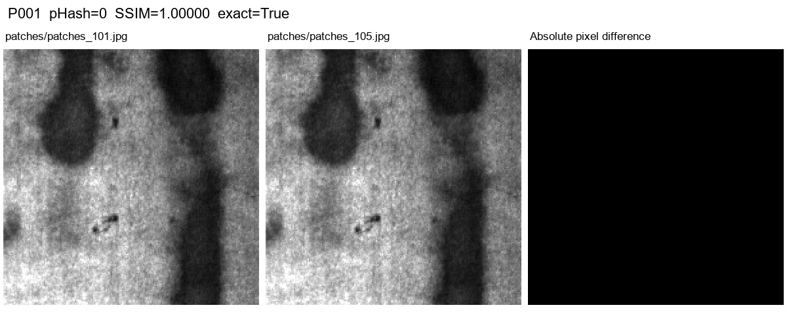

## P002：inclusion/inclusion_88.jpg / inclusion/inclusion_125.jpg
pHash=8；SSIM=0.77562；完全重复=False
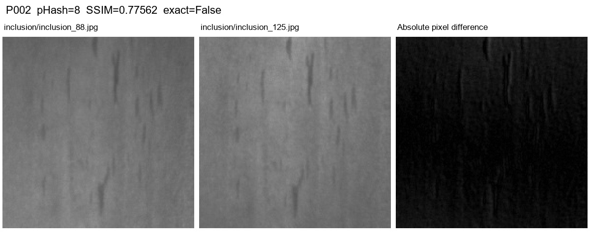

## P003：pitted_surface/pitted_surface_171.jpg / pitted_surface/pitted_surface_292.jpg
pHash=8；SSIM=0.55770；完全重复=False
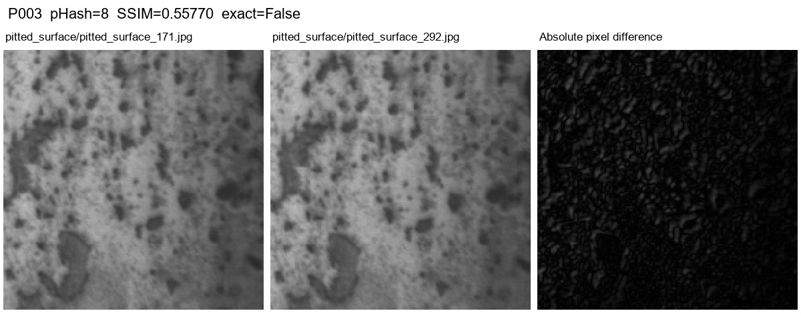

## P004：inclusion/inclusion_187.jpg / patches/patches_140.jpg
pHash=10；SSIM=0.28627；完全重复=False
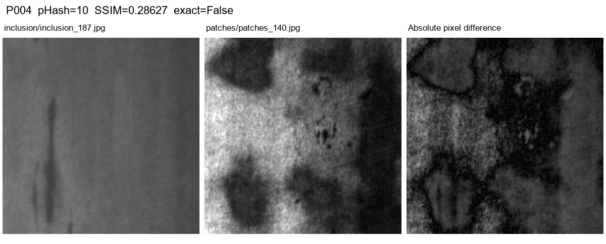

## P005：patches/patches_80.jpg / patches/patches_103.jpg
pHash=10；SSIM=0.14942；完全重复=False
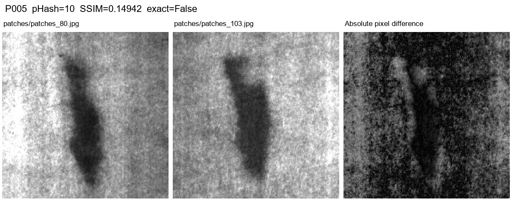

## P006：pitted_surface/pitted_surface_154.jpg / scratches/scratches_127.jpg
pHash=10；SSIM=0.52040；完全重复=False
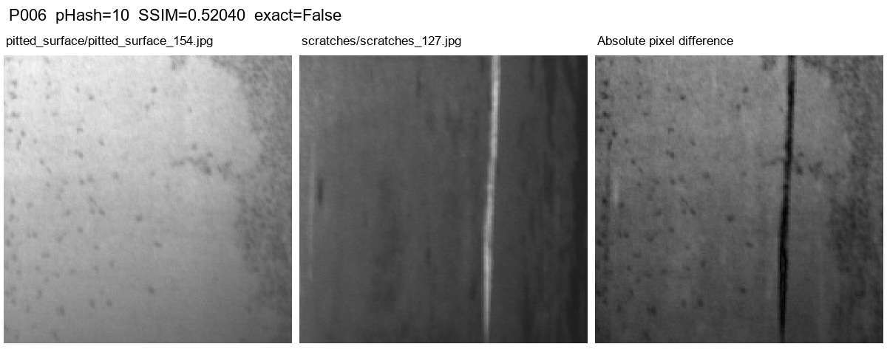

## P007：scratches/scratches_22.jpg / scratches/scratches_112.jpg
pHash=10；SSIM=0.75710；完全重复=False
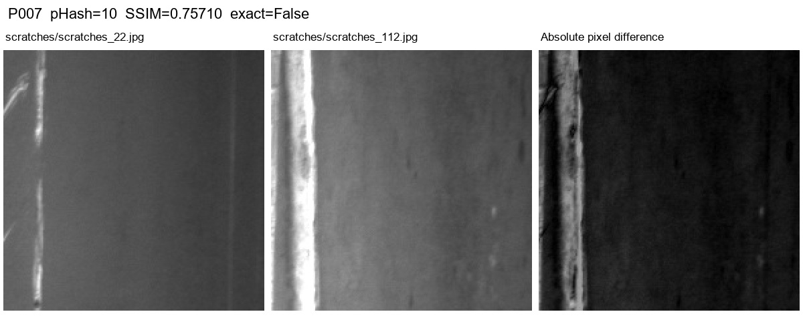

## P008：inclusion/inclusion_123.jpg / inclusion/inclusion_186.jpg
pHash=12；SSIM=0.75670；完全重复=False
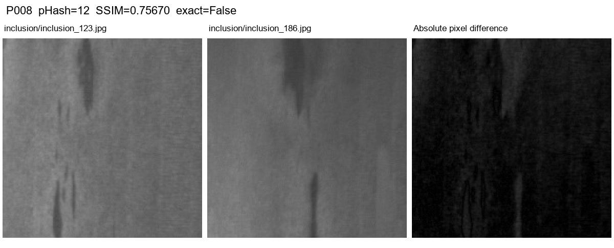

## P009：inclusion/inclusion_188.jpg / inclusion/inclusion_210.jpg
pHash=12；SSIM=0.88600；完全重复=False
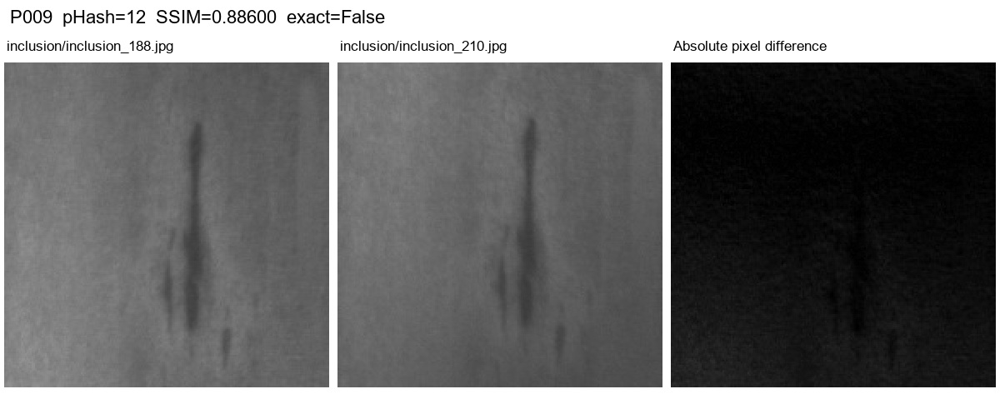

## P010：inclusion/inclusion_188.jpg / inclusion/inclusion_242.jpg
pHash=12；SSIM=0.54204；完全重复=False
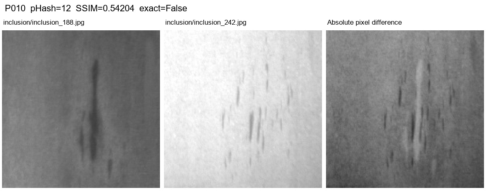

## P011：inclusion/inclusion_210.jpg / inclusion/inclusion_242.jpg
pHash=12；SSIM=0.52895；完全重复=False
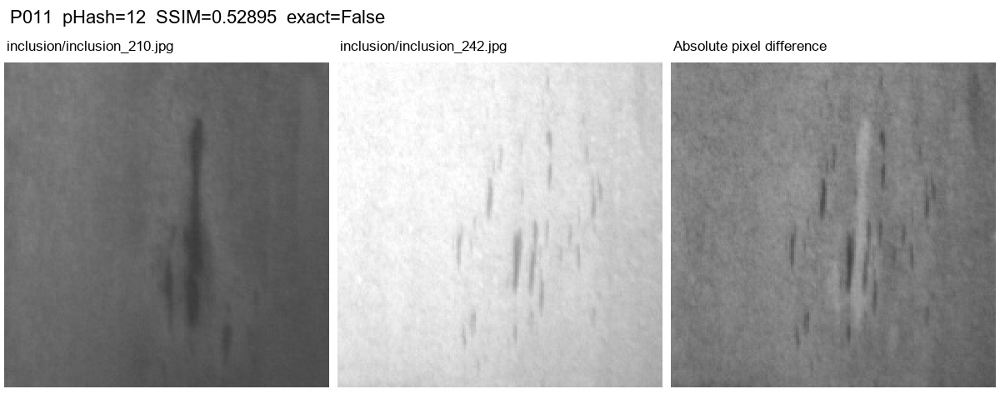

## P012：inclusion/inclusion_96.jpg / pitted_surface/pitted_surface_21.jpg
pHash=12；SSIM=0.46851；完全重复=False
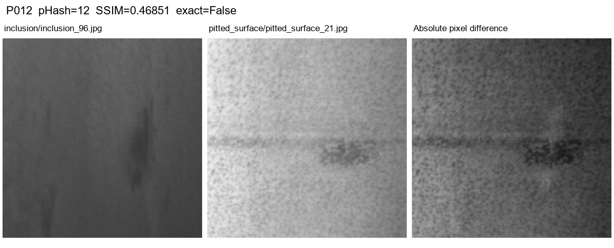

## P013：inclusion/inclusion_96.jpg / scratches/scratches_284.jpg
pHash=12；SSIM=0.70195；完全重复=False
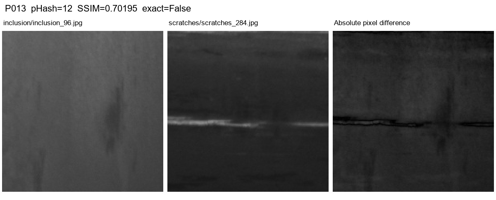

## P014：patches/patches_109.jpg / patches/patches_156.jpg
pHash=12；SSIM=0.13833；完全重复=False
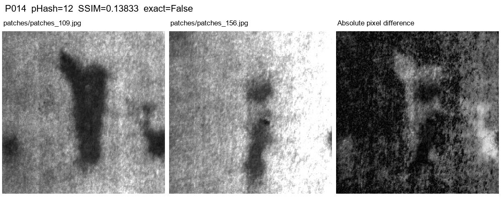

## P015：patches/patches_199.jpg / patches/patches_201.jpg
pHash=12；SSIM=0.13379；完全重复=False
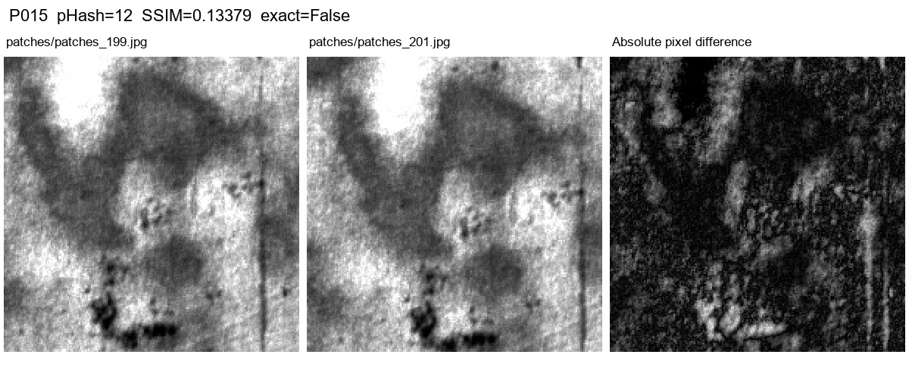

## P016：patches/patches_2.jpg / patches/patches_5.jpg
pHash=12；SSIM=0.20238；完全重复=False
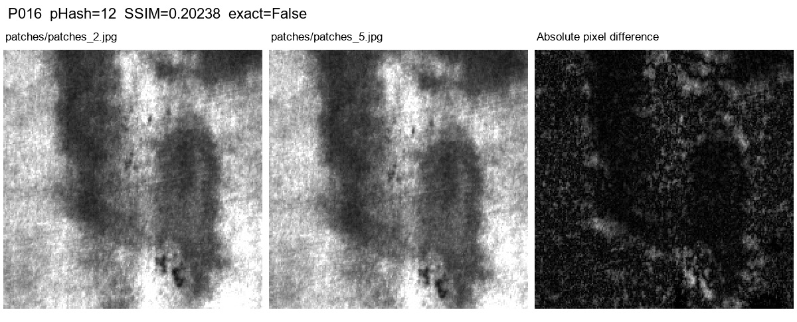

## P017：pitted_surface/pitted_surface_127.jpg / scratches/scratches_107.jpg
pHash=12；SSIM=0.67465；完全重复=False
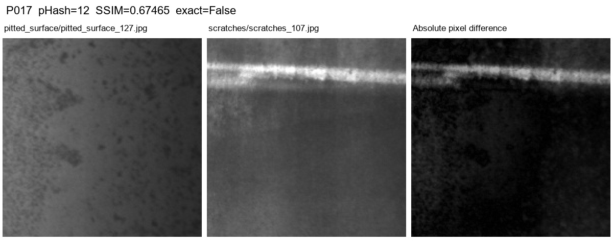

## P018：rolled-in_scale/rolled-in_scale_134.jpg / scratches/scratches_22.jpg
pHash=12；SSIM=0.34251；完全重复=False
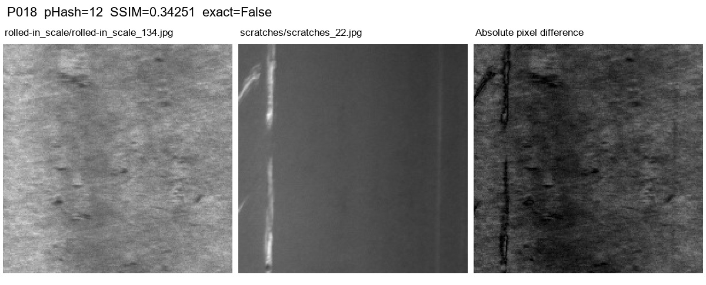

## P019：rolled-in_scale/rolled-in_scale_248.jpg / scratches/scratches_50.jpg
pHash=12；SSIM=0.43549；完全重复=False
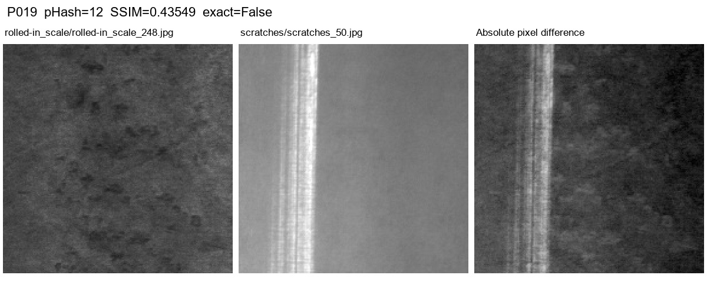
